# Curso BackEnd - 1º Semestre - 105h

prof. Diogo Barbosa

Escola SENAI Americana

2º Semestre

## Objetivos do Curso 

 - Desenvolver Aplicações web Serve Side, Utilizando a Linguagem PHP;
 - Aplicar Sintaxe nativa Php Vanilla;
 - Manipulação HTTP;
 - Persistência (armazenamento em BD);
 - Segurança contra SQL Ijection/CSRF;
 - Refatoração em POO (Programação Orientada Objeto);
 - Arquitetura MVC;
 - Utilização do FrameWork Laravel;
 
## Cronograma do Semestre

Carga Horária: 105h

Duração: 20 Semanas

### Introdução ao BackEnd e Configuração do Ambiente PHP

#### o que é BackEnd 

```https://dontpad.com/diogotb``` site do diogo para entar no live share 

O back-end é a parte de um site ou aplicativo que o usuário não vê, mas que faz tudo funcionar por trás das telas.

- Guarda e organiza informações em um banco de dados;
- Confere se o login e a senha estão corretos;
- Calcula valores, como o frete ou o total de uma compra;
- Garante que os dados de um usuário não apareçam para outro;
- Faz o sistema suportar muitas pessoas usando ao mesmo tempo, sem travar.

As principais linguagens utilizadas no desenvolvimento back-end são PHP, JavaScript/TypeScript, Python, Java, Kotlin, Go (Golang), C# e Rust. 

O backend é o "cérebro" oculto de um site ou aplicativo. Ele roda em um servidor e cuida de tudo o que o usuário não vê na tela.

**As 3 partes básicas de todo backend:**

1. **Servidor:** o "computador" que fica ligado esperando pedidos (requisições);
2. **Banco de dados:**  onde as informações ficam guardadas (usuários, produtos, mensagens, etc.);
3. **Lógica de negócio:**  as regras do sistema (ex: "não deixa comprar se não tiver estoque").

**O Mercado de Trabalho em Back-end**

O desenvolvimento Back-end é uma das áreas mais cruciais da Tecnologia da Informação. 

- Com a transformação digital acelerada, empresas de todos os portes e setores dependem de infraestruturas sólidas e seguras. 

- Setores de Atuação: Bancos, hospitais, e-commerces, logística, indústrias, startups e órgãos públicos utilizam Back-end para suportar suas operações críticas.

- Fatores de Crescimento: O avanço da computação em nuvem, aplicativos móveis, Big Data e IA impulsiona continuamente a busca por profissionais da área.

- Modelos de Trabalho: Alta flexibilidade com vagas presenciais, híbridas e remotas (inclusive com oportunidades internacionais).

#### Ciclo de vida da requisição HTTP

##### O que é HTTP 

**HTTP**, Hypertext Transfer Protocol, é um protocolo de comunicação utilizado para transferência de informações na WWW(World Wide Web) e em outros sistemas de Redes.

O HTTP é a base para que o cliente e um servidor web troquem informações. ele permite a requisição e a respostas de recursos, como imagens, arquivos e as próprias páginas web, por meio de mensagens padrão (protocolo).

#### Como Funciona  o HTTP 

1. O cliente estabelece o contato com o servidor, encaminhando uma requisição HTTP;
2. nesse Requisição o cliente especifica o método pretendido (read-GET, create-POST, update-PUT/PATCH, delete-DELETE);
3. O servidor processa e responde com uma mensagem HTTP, com os recursos  solicitado.

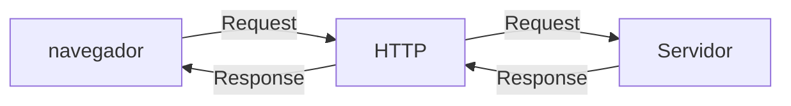
---

#### Como Funciona na Prática o BackEnd

- **Ação do Usuário**: Envia uma Solicitação pela UI(Interface do Usuário). Exemplo de UI: Tela do Celular, Navegador da Internet, Alexa ...
- **envio do resição**: a UI transforma ação do Usuário em uma requisição: A UI transforma ação do Usuário em uma Requisição HTTP
- **O Processamento BackEnd**: o Código Backend recebe o pedido, valida os dados e decide o que fazer (Ex: consulta uma informação no banco de dados)
- **Resposta**: O  Servidor devolver o resultado para a UI (EX. em Login autorizado, uma compra confirmada, )

---

#### Tipos de Requisição HTTP

Os tipos de de requisição HTTP indicam a ação que o usuário deseja executar no servidor. As principais ações são:

- **GET**: pede dados de um lugar especifico. "Não faz alterações mo servidor"
- **POST**: Enviar dados novos para *criar* algo ou processsar informações.
- **PUT/PATCH**: Modificar dados já existentes. *PUT* Atualização Total dos dados. *PATCH* Atualização Parcial dos dados.
- **DELETE**: Apaga um dado do servidor.
---

#### iniciando o PHP

#### O que é PHP 

**PHP** (Hypertext preprocessor) é uma linguagem de programação interpretada e open surce, Focada no desenvolvimento de sistemas para web, pode ser usada junto com HTML para criação de páginas web dinâmicas.

#### Instalando o PHP 

- Fazer o download do PHP (php.net);
- ZIP - non thread Safe 8.5 
- descopactar o arquivo do PHP na pasta C:\src\php (Para descompactar, usar o 7Zip = Melhor)
- modificar o arquivo php.ini -development para => php.ini (criar as configurações do PHP na máquina) - adicionar ou remover funcionalidade do PHP
- Adicionar a pasta do PHP(C:\src\php) as variaveis de ambiente do Sistema (PATH)
- verificar a instalação rodando o Comando php --version 

##### Contextualizando o PHP

o PHP de fato é uma das linguagens de Programção mais populares da atualizada. Ela permite que você crie aplicações web robustas, de uma maneira muito simplifica e direto ao ponto.
sem contar que a linguagem traz diversos recursos que facilitam e aceleram o processo de desenvolvimento de sites e sistemas par web.E alêm do mais, ela ainda tem um ótimo ecossitema, uma excelente comunidade e um grande mercado de trabalho. 

##### Criando minha primeira aplicação em PHP

criando um Hello, World!!!

##### Criando o perfil de PHPVanilla 

-> Profile -> new profile 
-> Extensions:
- PHP interPhense( Ado Elefantinho): AutoCompletar (Snipets)
- PHP Debug (Xdebug): acha Erros em Linha de Código
- PHP CS FIXER: Formatação padrão do código (Identação)
- PHP Server: Sobre um servidor Local para Acompanhamento em Tempo Real

##### Estudo de Variáveis e constantes em PHP

declarar variáveis é alocar um espaço na memoria que permite a inclusão e manipulação de dados.

**Variaveis**

- devem ser declaradas usando "$" antes do nome da variável
- podem ser String, Numérica (Integer e Float), Booleanas e Nulas. Não permite declaração de UndeFined
- São não tipadas ( não precisa declara o tipo na criação), a tipagem é atribuida ao adicionar o valor
- Usar o "declare(strict_types=1);" na primeira linha do arquivo ; => blindar o sistema contra conflitos de tipos de Variáveis.

**Constantes**

- não podem ser modificadas ou redeclaradas
após a criação
- pode ser criada usando "const" ou "define"
- não permitem interpolação 

---

### ### Semana 2 - Operadores em PHP (Aritméticos, Relacionais e Lógicos)

##### Estudo de Operadores

**Aritméticos**: São usados para realizar cálculos.

| Operador | Nome | Exemplo | Resultado |
| - | - | - | - |
| + | Adição | 10 + 5 | 15
| - | subtração | 10 - 5 | 5 |
| * | Multiplicação | 10 * 5 | 50 |
| / | Divisão | 10 / 5 | 2 |
| % | módulo (resto) | 10 % 3 | 1 (10 div 3 da 3, sobra 1) |
| ** | Expoente | 2 ** 3 | 8(2 elevado a 3) |

obs: O Operador % é o melhor amigo de um programador, permite ordenar listas e porganizar fila e pilhas

##### Estudo dos Relacionais 

Usados para comparar valores e retornar se é **true** e **false**

| Nomes | Operador | Exemplo | Resultado | 
| - | - | - | - | 
| Iguais  | == | "10" == 10 | true |
| Igualdade Escrita | === | "10" === 10 | false |
| Diferente | != | "10" != | false |
|diferença estrita | !== | "10"!==10 | true |
| Maior que | > | 18 > 18 | false | 
| Menor que | < | 10 < 20 | true |
| Maior ou Igual | >= | 18 >= 18 | true |
| Menor ou igual | <= | 10 <= 5 | false |

**Lógicos**: Permite a combinação entre sentenças.

- operador AND (&) => && : para o resultado se verdadeiro, TODAS as combinaçães precisam ser verdadeiras
  - true && true => true
  - true && false => false
- Operador OR (OU) => || : Basta APENAS UMA condição ser verdadeira
  - false || true => true
  - false || false => false

- Operador NOT (Não) => ! : Inverte a lógica da Sentença
  - !true => false
  - !false => true

### Semana 3 - Estrutura de controle de Dados (condicionais e Repetição)

- **Conteúdo**: Estruturas `if`, `else`, `elseif`, Operadores ternários, `match`, loops `for`, `while` `do-while` e `foreach`

#### Estrutura de controle de Dados ajudam no processo de automatização e, programas e sistemas

##### Condicionais (IF, ELSE, ELSEIF)

- **forma de uso**:

- uso do `if` apenas 
exemplo:aplicar um desconto de 10% em comrpas acima de 100 Reais; 

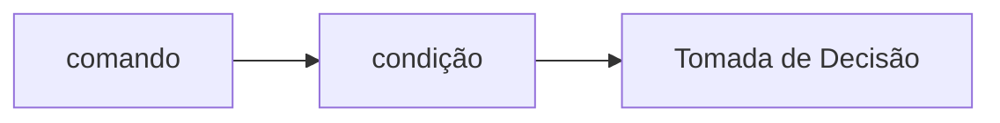

```php
if ($valorCompra > 100) {
  $valorCompra = $valorCompra * 0.1
}
```

- Uso do `if` e do `else`
Exemplo: Aplicar um desconto 10% para compras acima de 100 reais e 5% para as demais compras 

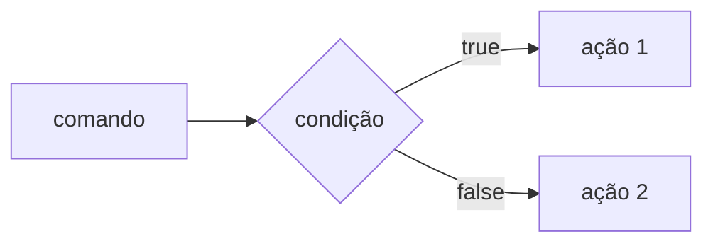

```php

if($valorCompra > 100) {
  $valorFinal = $valorCompra * 0.1
} else{
  $valorFinal = $valorCompra * 0.05;
}


```

- Uso do `elseif` (Encadeado)
Exemplo: Compras acima de 200 reais tem 15% de desconto, acima de 100 reais tem 10% de desconto e outras 5% de desconto

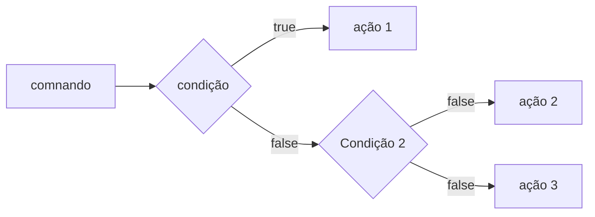

```php

if ($valorCompra > 200){
  $valorFinal = $valorCompra * 0.85;
} elseif($valorCompra > 100) {
  $valorFinal - $valorCompra * 0.9;
}else {
  $valorFinal = $valorCompra * 0.95;
}

```

*obs*: sempre usar `elseif` para situações que precisam de mais de uma condição, ou seja fazer encadeamento das condições.

- Uso **ERRADO** do if

Não fazer o encadeamento de condicionais 

```php

if($valorCompra > 200) {
  $valorFinal = $valorCompra*0.85;
}

if($valorCompra > 100) {
  $valorFinal = $valorCompra*0.90;
}

if($valorCompra > 100) {
  $valorFinal = $valorCompra*0.95;
}

```


##### Operadores ternários 
Um atalho para a estrutura condicional `if/else`, normalmente escrito em uma única linha de código

` condição ? verdadeira : falso `

perfeito para decições curtas de uma linha de comando
Exemplo: Verificar se Pessoa é maior de idade (18)

```php

$idade = 20;
//O formato é : (Condição) ? Verdadeira : Falso;

$status = ($idade >= 18) ? "Maior de Idade" : "Menor de idade";
$status2 = ($idade<18) ? "Criança" : ($idade<60) ? "Adulto" : "Idoso";

```

##### Expressão Condicional `match` (PHP 8)

No mercado de PHP atual, não se usa mais ema dezena de `if/else`
checar valores fixos, e o antigo `Seitch/case` caiu em desuso. Usamos o `match`. Ela compara um valor e retona diretamnete o resultado.

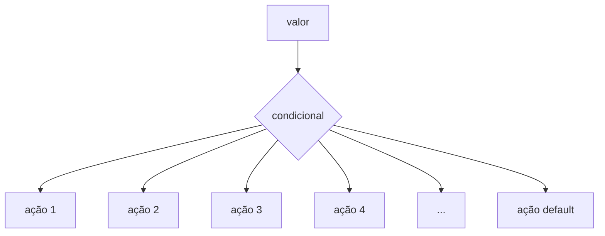

```php

$diaSemana = date("Week"); // pega o Dia da Semana em formato numérico

//Transforma dia da Semana em formato texto (Domingo, Segunda,...)

$nomeDiaSemana = match($diaSemana){
  "0" => "Domingo",
  "1" => "Segunda",
  "2" => "Terça",
  "3" => "Quarta",
  "4" => "Quinta",
  "5" => "Sexta",
  "6" => "Sábado",
  default => "Dia inválido"
};

```

---

##### Laços de Repetição 

Um laço de repetição faz com que, um bloco de códigos rode várias vezes, até que uma condição mande parar.

- O laço `while` (Enquanto)

Ele verifica se condição é verdadeira ANTES de entrar no laço. ideal quando você não sabe quantas vezes vai rodar o laço.

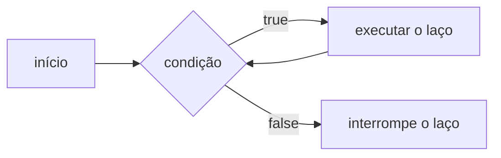

exemplo: Jogo de adivinhação de um nº Secreto

```php

$numeroSecreto = rand(1,10);

$tentativas = 0;

while($tentativa != $numeroSecreto){
  echo "tente novamente"
  //vou pegar um nº aleatório entre 1 e 10
  $tentativa = rand(1,10);
}

echo "acertou Miseravi !!! o nº secreto é $numeroSecreto";

```

 - O laço `do-while` (faça-Enquanto)

 a diferença é que ele execua o bloco pelo menos uma vez, mesmo que a condição seja falsa desde o início, pois ele só pergunta no final

 ```mermaid

 flowchart LR

A([Início]) --> B[Executar Ação]
B --> C{Condição}
C --true--> B
C --false--> D([Fim]) 

```

exemplo: jogo de adivinhação

```php

$numeroSecreto = rand(1,10);

do {
  $tentativa = rand(1,10);// Simular um palpite aleatório

  if($tentativa == $numeroSecreto){
    echo "parabéns, acertou!!!!";
    }

    } while ($tentativa != $numeroSecreto);

```

obs: Uso ideal do `d-while`, Menus de sistema ou sistema de solicitações de dados, siste,as interativos,

---

##### O Freio de Emergência: `break` e `continue`

As vezes precisamoso interferir no laço enquanto ele está rodando 

- `break`=> **Para Tudo!** Quebra o laço interiro e avai embora
- `continue` => **Pula a rodada!** Ele ignora o código daquela rodada especifica e pula logo par a próxima repetição.

Exemplo de Aplicação do Código: Sistema de Controle do Elevador

```php 

for($andar = 1 ; $andar<=10; $andar++){
    if($andar ==4){
        echo "Andar $andar está em obras. Passando direto!";
        continue;
    }

    echo "Elevador parou no andar $andar"
}

```
---

##### Laço de Repetição `for`

Use o `for`quando você sabe quanats vezes precisa repetir uma ação ou quando precisa conrolar um contador. ele possui 3 partes:

 - inicialização;
 - condição;
 - incremento;

 Sintaxe:

 for(inicialização; Condição; Incremeno) {
    ação
 }

 ```mermaid
 flowchart LR
      A[início: i=0] --> B{i<10?}
      B --true--> C[Ação]
      C --> D[i++]
      B --false--> E[FIM]
```

Exemplo de aplocação: Exibir todos os Meses do ano

```php
fo($mes=1;$mesM<=12;$mes++){
  echo "Mês $mes";
}
```
Nesse Exemplo, `$mes` começa em 1, o laço continua enquanto `$mes` for menor ou igual a 12 e, ao final de cada repetição, `mes` aumenta o contador em 1

##### Laço de Repetição `foreach`

use o `foreach` qaundo precisar percorrer cada item de um **array**. ele acessa os elementos diretamente, sem que você precise controlar o contador.

exemplo: imprimir todos os itens de um vetor.

```php
$frutas = ["maça", "banana", "uva", "laranja"];

foreach($frutas as $fruta){
  echo "fruta: $fruta";
}
```
Outro exemplo: Acessar a chave e o valor de cada intem:

```php
$preços = [
  "caderno" => 25.00,
  "caneta" => 5.50,
  "mochila" => 99.00
]; //vetor não ordenado do tipo Chave(key) => Valor(Value) ===> Coleção/Dicionário

//percorrer o vetor usando o laço foreach
foreach($precos as $produto => $preço) {
  echo "$produto: R$" . number_format($prco,2);
}
// acessa a chave e o valor de cada item do vetor
```

---
---

#### Desafio: Simulador de cobrança(FINASENAI)

#### Desafio Final
---
---

### Semana 4 - Modularização com funções

#### Principio do DRY (Don´t repeat yourself)

se uma lógica foi escrita duas ou mais vezes dentro de um código, essa lógica deve virar uma função.


#### Funções Nativas do PHP

o PHP tem milhares de funções prontas, essa função já criada é chamada de função nativa.

 - **o que é uma função?**

 uma função é como uma máquina: você coloca a matéria-prima(Parâmetros), ela processa e devolve um produto final (retorno)

 Exemplo de função Nativa 

 ```php
 $texto = "senai americana";

 // usar uma função nativa para substituição de parte do texto ==> str_replace
 $textoNovo = str_replace("americana", "são paulo", $texto);
 // "senai são paulo"

 //usar uma função nativa para substituição das letras minúsculas por letras maiúsculas  => strtoupper
 echo strtoupper($textonovo);//SENAI SÃO PAULO
 ```

##### Principais funções Nativas (Mais Utilizadas)

As funções abaixo já fazem parte do PHP e podem ser chamadas diretamente no código. Observe os parâmetros que cada uma recebe e o tipo de informação que ela retorna.

| Função | Categoria | O que faz | Como usar |
|---|---|---|---|
| `strlen()` | Strings | Retorna a quantidade de caracteres de um texto. | `$tamanho = strlen($texto);` |
| `strtoupper()` | Strings | Converte o texto para letras maiúsculas. | `$resultado = strtoupper($texto);` |
| `strtolower()` | Strings | Converte o texto para letras minúsculas. | `$resultado = strtolower($texto);` |
| `ucfirst()` | Strings | Converte a primeira letra do texto para maiúscula. | `$resultado = ucfirst($texto);` |
| `trim()` | Strings | Remove espaços e quebras de linha no início e no fim do texto. | `$limpo = trim($texto);` |
| `str_replace()` | Strings | Substitui uma parte do texto por outra. | `$novo = str_replace("-", "", $cpf);` |
| `substr()` | Strings | Extrai uma parte do texto a partir de uma posição. | `$inicio = substr($texto, 0, 3);` |
| `explode()` | Strings | Divide um texto e cria um array usando um separador. | `$palavras = explode(" ", $nome);` |
| `implode()` | Arrays | Junta os itens de um array em um único texto. | `$lista = implode(", ", $nomes);` |
| `count()` | Arrays | Conta a quantidade de itens de um array. | `$total = count($produtos);` |
| `in_array()` | Arrays | Verifica se um valor existe dentro de um array. | `$existe = in_array("SP", $estados, true);` |
| `array_push()` | Arrays | Adiciona um ou mais itens ao final de um array. | `array_push($nomes, "Ana");` |
| `array_pop()` | Arrays | Remove e retorna o último item de um array. | `$ultimo = array_pop($nomes);` |
| `sort()` | Arrays | Ordena um array em ordem crescente e reorganiza suas chaves. | `sort($notas);` |
| `array_keys()` | Arrays | Retorna um array contendo as chaves de outro array. | `$chaves = array_keys($produtos);` |
| `number_format()` | Números | Formata um número com casas decimais e separadores definidos. | `$preco = number_format($valor, 2, ',', '.');` |
| `round()` | Números | Arredonda um número para a quantidade de casas informada. | `$media = round($nota, 2);` |
| `max()` | Números | Retorna o maior valor de uma lista ou array. | `$maior = max($notas);` |
| `min()` | Números | Retorna o menor valor de uma lista ou array. | `$menor = min($notas);` |
| `is_numeric()` | Validação | Verifica se o valor é um número ou uma string numérica. | `if (is_numeric($entrada)) { ... }` |
| `isset()` | Validação | Verifica se uma variável existe e não possui valor `null`. | `if (isset($usuario)) { ... }` |
| `empty()` | Validação | Verifica se uma variável está vazia. | `if (empty($pedido)) { ... }` |
| `date()` | Data e hora | Formata uma data ou hora conforme uma máscara. | `$hoje = date('d/m/Y');` |
| `file_exists()` | Arquivos | Verifica se um arquivo ou diretório existe. | `if (file_exists('dados.txt')) { ... }` |
| `file_get_contents()` | Arquivos | Lê todo o conteúdo de um arquivo ou endereço. | `$conteudo = file_get_contents('dados.txt');` |
| `file_put_contents()` | Arquivos | Grava conteúdo em um arquivo, criando-o se necessário. | `file_put_contents('log.txt', $mensagem);` |

**Atenção:** algumas funções modificam o array original, como `sort()`, `array_push()` e `array_pop()`. Já outras retornam um novo valor, como `count()`, `explode()` e `str_replace()`. Em caso de dúvida, consulte a documentação oficial do PHP e verifique o retorno da função.


##### Documentação PHP

[acesse a documentação oficial do PHP em português](https://www.php.net/manual/pt_BR/)

Consulte também a [referência de funções do PHP em ](https://www.php.net/manual/pt_BR/funcref.php) para pesquisa a sintaxe, osparâmetros e os valores para cada função.

#### Funções Customizadas (Criando suas próprias máquinas)

quando o PHP não tem a função que queremos, nós a criamos!

**A Regra de ouro**: Uma função deve focar em `return` (retornar um valor), e não imprimir (`echo`).

Veja a diferença nesse exemplo:

```php
function calcularTotal($preco, $quantidade){
  // a função calcula e retorna o resultado, mas não imprimi nada
  return $preco * $quantidade;
}

$total = calcularTotal(25.00, 3);

//imprimir é feito fora da função
echo "Total da compra: R$ " .round($total,2);
// Total da compra: R$ 75.00
```

A função `calcularTotal()` pode ser reutilizada em uma página, relatório ou teste. O `echo` aparece somente fora da função, no momento de apresentar o resultado para o usuário.

##### Padrão de uso corporativo (PHP 8 Strit types)

no mercado de trabalho, exigimos que a função avise exatamente o **TIPO** de dado que ela espera  receber e o **TIPO** de dado que ela vai devolver.

isso é chamado de **tipagem de funções**. ao declarar os tipos, o código fica mais fácil de entender e o PHP consegue identificar alguns erros antes que eles causem problemas maiores no sistema.

Os tipos mais usados:

*`int`: número inteiro, `10` ou `1024`;
*`float`:número decimal ou ponto flutuante, `10.90`;
*`string`: Texto, como `"Maria"`;
*`bool`: valor lógico, `true` ou `false`;
*`void`: identificar que a função não devolve nenhum valor;

O tipo deve ser escrito antes do nome de cada parâmetro e o tipo da função deve ser escrito após os parênteses, precedido do ":", informando o que a função vai devolver 

Exemplo de uso de função e parâmetros tipados:

```php
function apresentasProduto(string $nome, float $preço): string{
  return "$nome custa R$ $precp";
}

$mensagem = apresenatrproduto("caderno", 25.00);
echo $mensagem;
// Caderno custa R$ 25.90
```

>**Resumo**: os tipos dos parâmetros documentam as entradas da função, o tipo após `:` documenta a saída da função.

##### O tipo Mágico: `VOID`

se uma função faz um trablho interno e **não retorna NADA**,
dizemos que o retorno dela é "vazio" (`void`).

Exemplo de função sem retorno:

```php
function registraLog(string $mensagem): void{
  //apenas salva em um arquivo de texto, não devolve nenhuma variável
  file_put_contents("erro.log",$mensagem);

}
```

#### Escopo e Referencia (o Segredo da Memória)

##### O que é Escopo? (A Regra de Las Vegas)

*O que acontece dentro da função, fica dentro da função*. Uma variável criada fora não existe la dentro, e uma criada lá dentro morre quando a função acaba.

**Escopo** é o local do programa onde a variável pode ser armazenada/acessada. Em PHP, uma variável criada fora de uma função pertece ao *escopo global*, uma variável criada dentro de uma função pertende ao *escopo local*.

Exemplo de Escopo de variável:

```php 
$nomeSistema = "CRM SENAI";//variável global

function criarMensagem(string $nome): string{
  $mensagem = "Bem-vindo!!!";//escopo Local
  return $mensagem . $nome;
}

echo $nomeSistema; //correto: esta no escopo global
//echo $mensagem;//Errado: $mensagem só existe dentro da função, não é acessada fora
echo criarMensagem("nome do fulano")//correto: A função devolve sua variável local
//CSM SENAI
//Bem-bindo! nome do fulano
```

*como enviar Dados para uma função*

A forma mais segura e organizada é envirar os dados por **Parâmetros**. Assim, a função precisa acessar diretamente variáveis globais:

```php

function saudar(string $nome):string {
  return "Olá, $nome!";
}

$nomeCliente = "joão";
echo saudar($nomeCliente);// Olá, joão
```

nesse caso , `$nomeCliente` continua no escopo global, mas seu valor é enviado para parâmetro local `$nome`. Afunção recebe uma informação, processa e retorna o resultado.

**Exemplo Incorreto**

```php
$nome = "joão"; //variável global

function saudar() :string{
  return "Olá, $nome";//Errado: a função não reconhece a variável global
}
```
A função `saudar()`não conhece a variável global `$nome`. Ocasionando um erro no sistema.

> **Resumo**: variáveis protegem os dados internos da função; parâmetros são o caminho recomendado para evitar Erros e enviar Informações, e `return`é usado para devolver um resultado ao códgio que chamou a função.

---

### Semana 5 - Arrays e Manipulação Avançada de Dados

Um array (também conhecido como vetor) é uma estrutura de dados usada para armazenar vários valores em uma única variável.

**Tipos de Arrays em PHP**

 - Indexados/Ordenados(Númericos): Usam Números inteiriros como índices(chaves), que começam em zero por padrão;
 - Associativos/Não Ordenados(Strings): Usam chaves(String) para identificar valores;
 - Multidimensionais: Contêm um ou mais arrays dentro de outros arrays. 

 **Exemplo de Arrays:**

 ```php
 //array indexado
 $frutas = ["maça", "banana", "laranja"];

 //array associativo
 $capitais = [
  "SP" => "São Paulo",
  "MG" => "Belo Horizonte",
  "RJ" => "Rio de Janeiro",
  "ES" => "Vitória"
 ];

 //acessando Dados
 echo $fruta[0]; //"maça"
 echo $capitais["SP"]; //São Paulo

 ```

 >Obs: Em arrays associativos, nos trocamos os nº do índice por Nomes(Chaves/Keys). A setinha => significa "recebe"

 **Arrays Multidimensionais (Banco de dados na Memória)

 É aqui que o "BackEnd" começa de verdade. o Array Muntidimensional é o formato como os Bancos de Dados chegar como respostas as solicitações feitas pela API.

 **Exemplo de Aplicação de Array Multidimensional**
 
 ```php

 $cliente = [
    ["id" => 1, "nome"=>"Ana", "email"=>"ana@email.com", "ativo"=> "ativo" => true ],
    ["id" => 2, "nome"=>"Caio", "email"=>"caio@email.com", "ativo" => false],
    ["id" => 3, "nome"=>"João", "email"=>"joão@email.com" "ativo" => true]
 ];

 //Como Acessar o email do Bruno 
 echo $clientes[1]["email"]; //bruno@gmail.com

```

#### O melhor Amigo dos Array: `o foreach`

o laço de repetição especial para arrays. o `foreach` percorre cada elemento de um arrray.

**Exemplo de aplicação:**

```php
foreach($clientes as $clienteAtual){
  echo $clienteAtual["nome"];
  echo $clienteAtual["email"];
}
// vai emprimir nome e email de todos os Clientes do Array


```

#### Transformações de Arrays

São Usadas em Filtragem de e Mapeamento de dados de um Array

- `array_filter` 
Serve para buscar dados. e devolve apenas os dados que passarem pelo filtro

```php
$clientesAtivos = array_filter($clientes, fn($c) => $c["ativo"]===true);

//novo array, tera apenas os clientes que ativo for igual a true
```

- `array_map`
serve para alterar Todos de uma lista de única vez 

```php
$produtos = [
  ["id"=>1, "preco"=10.00, "setor"=>"jardim"],
  ["id"=>2, "preco"=15.00, "setor"=>"ferramentas"],
  ["id"=>3, "preco"=20.00, "setor"=>"jardim"],
]

// ajuste de preço em 10%
$produtosAjustados = array_map(fn($p)=>$p[preco] = $p[preco]*1.1, $produtos);
```

#### Debugando um Array (Kit primeiro Socorros)


- `print_r`
função usada para exibir informações sobre uma variávels de forma legível em linguagem natural

```php 
print_r($frutas);

//Array
(
    [0] => "maça",
    [1] => "banana",
    [2] => "laranja"
)
```

- `var_dump` 
exibi com mais detalhes as informações de um array ou variável em PHP

```php
echo var_dump($frutas);
//Mostra Tudo: tipo de dados, o tamanho e o valor
```
---

### Semana 6 - processamento HHTP e formulários web

#### Anatomia de um formulário HTML para BackEnd

antes do PHP processar qualquer informação, precisamos coletar informações no frontEnd através de um `<from>` 

** exemplo de `<form>` HTML 

```html
<form action="processa.php" method="POST">
  <label>Nome completo </label>
  <input type="text" id="campoNome" name="nomeUsuario"
  placeholder="Digite seu nome">
  <button type="submit">Cadastrar</button>
</form>
```

**O 3 pilares do Formulário**
1. action="processa.php" --> O Destino: Define qual script PHP no servidor receberá os dados.
2. method="POST" --> O Transporte: Define a via de protocolo HTTP usada(GET ou POST).
3. name="nomeUsuarios" --> A etiqueta do Dado: É o nome da chave que o PHP usará no array associativo ($POST["nomeUsuario"]).

> obs: Nunca Confundir `id` com `name` no input, o PHP ignora o `id`

#### O Protocolo HTTP

Quando o Usuário clica no botão `type="submit"` , o navegador compila todas as infotmções dos campos preenchidos e dispara um pacote de comunicação padronizado pelo **Protocolo HTTP(Hypertext Tranfer Protocol)**

- **O formato de Tranferência**

- **Método GET**: Solicitar informações públicas e realizar buscas, mas altamente arriscada paa dados privados.

- **método POST**: As informações viajam guardadas dentro do protocolo

#### Testar o uso dos protocolos HTTP 

```json
{
  "usuarios": [
    {
      "id": "1",
      "nome": "Maria",
      "idade": 25,
      "ativo": true
    },
    {
      "id": "2",
      "nome": "José",
      "idade": 27,
      "ativo": true
    },
    {
      "id": "3",
      "nome": "João",
      "idade": 22,
      "ativo": false
    },
    {
      "id": "4",
      "nome": "Helena",
      "idade": 28,
      "ativo": false
    },
    {
      "nome": "laura",
      "idade": 31,
      "ativo": true,
      "id": "YD7HvFYOONc"
    }
  ],
  "$schema": "./node_modules/json-server/schema.json"
}
```
>usando .json e thunder client para melhor didática 

---

#### GET vs.POST

1. O Método GET (Consultas e filtros)

O método `GET` é utilizado quando a intenção do cliente é **buscar ou filtrar dados** sem alterar o estado do servidor. Os dados enviados via `GET` são anexados diretamente ao final da URL na forma de uma **Query String**

2. O Método POST (envio de cargas Úteis e Mutações)

O método `POST` é utilizado o formulário envia dados que devem ser processados para **criar ou modificar registros** no sistema (ex: cadastro de usuáriosm, finalizações de comprar, upload de arquivos)


#### Como os métodos funcionam no PHP (`$_GET`, `$_POST`, `$_SERVER`) - As SuperGlobais

As variáveis SuperGlobais são arrays internos pré-definidos que estão sempre acessiveis em qualquer parte do script php,sem precisar ser declaradas.

- **_GET**: Armazena dados passados pela URL via parâmetros de consulta(query string);
- **_POST**: recolhe dados enviados por formulários usado método HTTP POST.
- **_SERVER**: contém informações sobre o servidor, ambiente e caminhos de script

**Porque usamos `??` para obter dados da SuperGlobal??**

Usamos o Operador de Nulidade (coalescência Nula) para verificar se o valor da variável não é `null`, se caso for `null` atribuimos um valor para evitar erros no script.

**Exemplo de Uso**:

Na primeira vez que uma página é aberta, o formuário ainda não foi enviado. portanto, a chave pode não existir no array.

```php
$nome = $_POST["nome"];
// se escreve desta forma, o código pode gerar im aviso de erro.

// a forma correta de escrita é
$nome = $_POST["nome"];
//se $_POST["nome"] não existir, use uma string vazia.

//outra forma de verificar nulidade é usando if/else
if(isset($_POST["nome"])){
    $nome = $_POST["nome"];
}else{
    $nome = "";
}
```

#### Validação de dados no BackEnd é Obrigatória 

Muitos desenvolvedores iniciantes acreditam que colocar atributos `required`, `type="email"` ou `min=0` ma <tag> do HTML é suficiente para proteger o sistema. **isso é ilusão**. sempre devemos fazer validações de dados no código BackEnd. As validações no BackEnd devem acontecer sempre antes do precessamento de qualquer dado recebido pelo usuário.

##### Funções Nativas essenciais para Limpeza e Validação de Dados.

Abaixo está uma tabela resumida das funções nativas do PHP usadas com frequência para limpar, verificar e validar entradas de formulário.

| Função | Descrição | Quando usar | Exemplo simples |
| :--- | :--- | :--- | :--- |
| `trim($valor)` | Remove espaços no início e no fim da string | Limpar texto digitado pelo usuário | `$nome = trim($_POST['nome'] ?? '');` |
| `htmlspecialchars($valor, ENT_QUOTES, 'UTF-8')` | Converte caracteres especiais em entidades HTML seguras | Exibir dados na tela sem risco de XSS | `echo htmlspecialchars($_POST['nome'] ?? '', ENT_QUOTES, 'UTF-8');` |
| `filter_var($valor, FILTER_VALIDATE_EMAIL)` | Valida formato de e-mail | Campos de e-mail | `filter_var($email, FILTER_VALIDATE_EMAIL)` |
| `filter_var($valor, FILTER_VALIDATE_INT)` | Verifica se o valor é inteiro válido | Idade, código, quantidade | `filter_var($_POST['idade'] ?? '', FILTER_VALIDATE_INT)` |
| `filter_var($valor, FILTER_VALIDATE_FLOAT)` | Verifica se o valor é número decimal válido | Preço, peso, altura, salário | `filter_var($_POST['preco'] ?? '', FILTER_VALIDATE_FLOAT)` |
| `isset($variavel)` | Verifica se uma variável existe e não é `null` | Garantir que o campo foi enviado | `if (isset($_POST['nome'])) { ... }` |
| `empty($valor)` | Verifica se o valor está vazio | Campos obrigatórios | `if (empty($_POST['senha'])) { ... }` |
| `strlen($valor)` | Retorna o tamanho da string | Exigir mínimo ou máximo de caracteres | `if (strlen($senha) < 6) { ... }` |
| `in_array($valor, $lista, true)` | Verifica se o valor pertence a uma lista permitida | `select`, `radio`, opções válidas | `in_array($categoria, ['A','B','C'], true)` |
| `is_numeric($valor)` | Confirma se o valor é numérico | Validação de número | `if (is_numeric($_POST['quantidade'])) { ... }` |
| `preg_match($padrao, $valor)` | Valida por expressão regular | CPF, CEP, telefone, senha forte | `preg_match('/^\d{5}-\d{3}$/', $cep)` |
| `filter_input(INPUT_POST, 'campo', FILTER_SANITIZE_SPECIAL_CHARS)` | Captura e limpa dados da requisição | Ler entradas com segurança | `$nome = filter_input(INPUT_POST, 'nome', FILTER_SANITIZE_SPECIAL_CHARS);` |


>obs: use `htmlspecialchars()` ao exibir valor em HTML => converte caracteres especias em entidades correspondentes em HTML, evitando que o código seja interpretado erradamente pelo navegador. É usado principalmente na segurança web, para eviar ataques cross-site-scriptinf(XSS).

#### Preservação de Estado em formulários (*Sticky From*)

A técnica do **Sticky form** consiste em imprimir de volta o valor no atributo "value" do input, os dados que usuário acaba de digitar,os valores são devolvidos aos inputs, caso ocorra algum erro de validação de dados no envio. 

**Exemplo de Uso:**

```php
<div class="campo">
    <label for="nome">Nome Completo</label>
    <input type="text" id="nome" name="nome" 
            value="<?= htmlspecialchars($dadosFormulario['nome'] ?? '') ?>"
            class="<?= isset($erro['nome']) ? 'input-erro' : '' ?>">
    <?php if (isset($erro["nome"])): ?>
        <span class="erro-texto"><?= $erro["nome"] ?></span>
    <?php endif; ?>
</div>
```


---


### Semana 7 - Segurança no BackEnd - Sanitização, Validação e Proteção contra XSS

**1º Mandamento do Desenvolvedor BackEnd**

> Nunca Confie no Usuário: Toda entrada de dados vinda de fora do servidor é potencialmente maliciosa até que seja rigorosamente validade, sanitizada e codificada.

Quando você disponibiliza um campo de texto em um site, qualquer pessoa conectad a internet pode digitar código maliciosos em vez de texto. Se o código BackEnd pega esse texto diretamente sem nenhum tratamento, a ordem de execução de código abrirá portas para a invasão devastadora do sistema.


**A Anatomia de um ataque: O que é Cross-site Scripting (XSS)**


O XSS ocorre quando uma aplicação web inclui dados não confiáveis em uma página web sem a devida validação ou escape de caracteres. Isso, permite que um atacante execute scripts maliciosos (geralmente em JavaScript) diretamente no navegadopr de outro usuário que visitam o site.

**As principais modalidades de Ataque**

1. *roubo de Sessão(cookies stealing)*: O JavaScript injetado lê os cookies de autenticação da vítima (document.cookie) e os envia para o servidor do atacante, permitindo que ele faça login na conta da vítima sem precisar da senha.

2. *Desconfigurção do Site(defacement)*: Alteração visual do site, inseridno mensagens falsas, banners ofensivos ou formulários de login fraudulentos(phising interno).

3. *Redirecionamento Malicioso*: Força o navegador da vítima a abrir sites com vírus ou páginas clonadas de banco.

4.*Captura de Teclas(keylogger)*: Grava tudo que a vítima enquanto a página estiver aberta.

**Os Vetores de Ataques Mais Frequentes**:

Nem todo ataque XSS usa a tag óbvia `<script>`. Desenvolvedores que tentam bloquear XSS apenas "apagando a palavra script" são facilmente burlados por atacantes:

| Vetor de Injeção | Como funciona o ataque? |
| :--- | :--- |
| `<script>alert('XSS')</script>` | Injeção direta de bloco de script executável pelo navegador. |
| `` | O navegador tenta carregar a imagem inexistente e dispara o evento `onerror` com o JavaScript. |
| `<svg onload="alert('XSS')">` | O navegador renderiza o elemento gráfico SVG e executa o evento `onload`. |
| `<a href="javascript:alert('XSS')">Clique</a>` | O clique no link executa a pseudo-URL com JavaScript em vez de abrir um site. |
| `"><script>alert('XSS')</script>` | Usado quando o dado é impresso dentro de um `<input value="...">`, quebrando o atributo e injetando a tag. |

#### **A Tríade de Defesa: Validação, Sanitização e Escapamento**

1. **Validação**: Verifica se o dado recebido atende aos requisitos exatos do sistema(tipo, tamanho, formato).

ex: Verificar se o e-mail possui `@` e dominio válido (`filter_var$email, FILTER_VALIDADE_EMAIL`).

2. **Sanitização**: Transforme o dado para adequa-lo ao formato desejado, removendo caracteres indesejados.

Ex: Remover no ínicio e fim(`trim($nome)`).

3. **Escapamento/Codificação de saída**: é o ato de converter caracteres especiais de linguagem HTML em suas respectivas **Entidades HTML** no momento exato em que eles são impressos na tela.

ex: usar `htmlspecialchars()`.

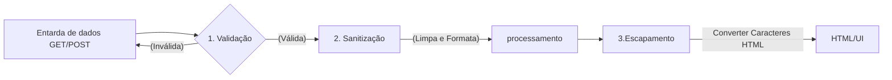

---

#### **A ferramenta princípal: `htmlspecialchars()`**

É o princípal mecanismo do PHP para neutralizar XSS na camada de Apresentação(UI)

**Como a conversão de entidades HTML funciona?**

| Caractere Original | Entidade HTML Gerada | Efeito no Navegador |
| :---: | :---: | :--- |
| `<` | `&lt;` (*Less Than*) | O navegador exibe `<` na tela, mas **não cria uma tag**. |
| `>` | `&gt;` (*Greater Than*) | O navegador exibe `>` na tela sem fechar tags. |
| `"` | `&quot;` (*Quotation Mark*) | Não quebra atributos HTML `<input value="...">`. |
| `'` | `&#039;` ou `&apos;` | Protege strings envoltas em aspas simples. |
| `&` | `&amp;` (*Ampersand*) | Evita interpretação incorreta de entidades. |

**A sintaxe no PHP**

```php
string htmlspecialchars(
  string $string,
  int $falgs = ENT_QUOTES | ENT_SUBSTITUTE | ENT_HTML5,
  ?string $encoding = "UTF-8
)
```
- `ENT_QUOTES`: Converte tanto aspas duplas quanto aspas simples
- `ENT_SUBSTITUTE`: Substitui sequências de bytes inválidos por caractres de substituição unicode em vez de retornar uma string vazia
- `ENT_HTML5`: aplica a tabela de entidade compatíveis com a especificação HTML5
- `UTF-8`: Garante que caracteres de lingua portuguesa com "ç", "ã",
"é" sejam preservados em corrupção.


**A função helper de Escapamento**

para não digitar essa linha extensa em todas as partes de saída de texto para HTML, os desenvolvedores profissionais criam uma função auxuliar curta:

```php
function e(string $texto):string{
  return htmlspecialchars($texto, ENT_QUOTES | ENT_SUBSTITUTE | ENT_HTML5, "UTF-8");
}

<p>Comentário: <?= e($comentarioUsuario) ?></p>
<input type= "text" name= "nome" value="<?= e($nomeUsuario) ?>" />

```

#### **Validação e Sanitização com `filter_var()`**

O PHP possui a biblioteca de filtros nativos `filter_var()`.


```php
<?php
declare(strict_types=1);

// 1. Validação de E-mail
$email = "usuario.teste@senai.br";
if (filter_var($email, FILTER_VALIDATE_EMAIL) !== false) {
    // E-mail válido
}

// 2. Validação de Número Inteiro com Limites (Range)
$idade = "25";
$opcoesIdade = [
    'options' => [
        'min_range' => 16,
        'max_range' => 120
    ]
];
if (filter_var($idade, FILTER_VALIDATE_INT, $opcoesIdade) !== false) {
    // Idade é um inteiro entre 16 e 120
}

// 3. Validação de URLs (Links)
$website = "https://www.sp.senai.br";
if (filter_var($website, FILTER_VALIDATE_URL) !== false) {
    // URL possui protocolo e formato válidos
}

// 4. Validação de Endereço IP
$ip = "192.168.1.100";
if (filter_var($ip, FILTER_VALIDATE_IP) !== false) {
    // IP válido
}

```

---

### Semana 8 - Persistência de dados com Banco de dados relacionado (postGresSql) e Conexão PDO

 **Tema:** Camada de acesso a Dados, Driver PDO(PHP Data Objects), Drive `pdo_pgsql`, Padrão Singleton, Isolamento de Credenciais (.env) e Tratamento de Exceções (PDOException) 

#### **1. Da memoria Volátil ao Banco de Dados**

Em sistemas corporativos de grande porte, arquivos planos(.txt .json) não oferecem a segurança, integridade, concorrência e velocidade necessárias para aramazenamento de dados. Então é aqui que o **BackEnd encontrao Banco de Dados Relacional**.

Banco de Dados Realacional permitem:

 - conectar a lógica de programação server-side ao Sistema de Gerenciamento de Banco de Dados (SGBD)
 - Garantindo persistência definitiva e segura dos registros
 - Aplicado integridade referencial, constraints, consultas otimizadas e propriedade ACID aprendidas na disciplina de Banco de dados

 > obs: Atomicidade, assegura que cada transação seja unica. Consistência, respeite todas as regras, restrições e chaves definidas, garantindo a validade da transação. Isolamento, transações de forma independente, Durabilidade, transações são confirmadas, garantindo a persistêcia permanente.

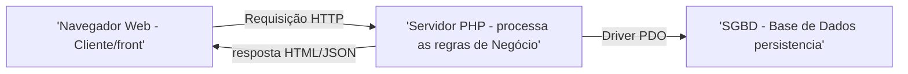

#### **2. O que é o PDO(PHP Data Objects)?**

O **PDO** é uma camada de abstração de acesso a dados integrada nativamente ao PHP. Ele fornece uma interface uniforme e orintada a objetos para se comunicar com múltiplos sistemas de banco de dados
(PostgreSQL, MySQL, SQLite, OracleSQL, SQLServer)

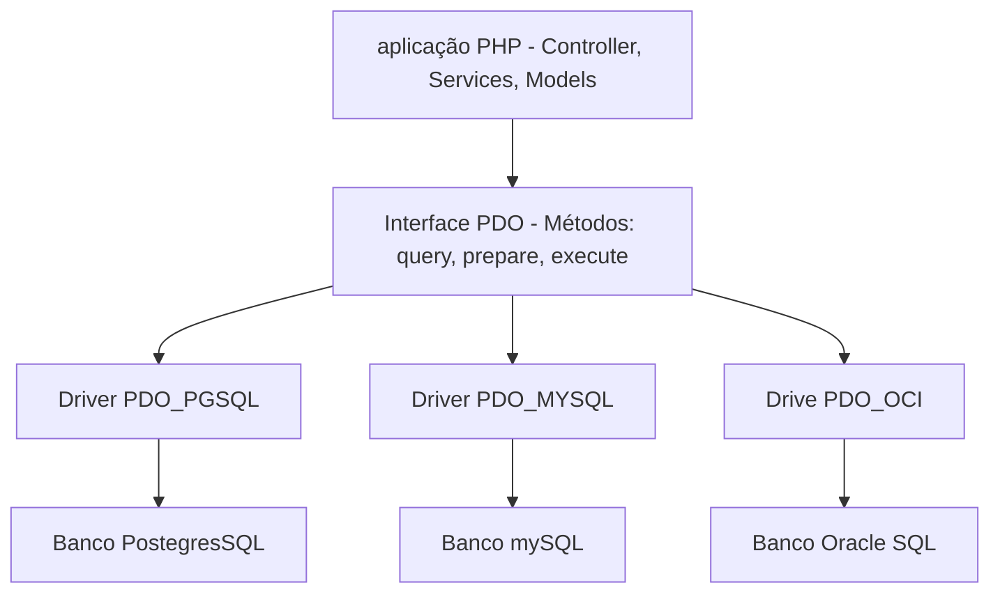

#### **3. Vantagens do uso PDO**

 - **Portabilidade de código**: Os métodos de conexão, consulta e transações são idênticos, independente do banco utilizando. se o cliente migrar do banco postgreSQL para outro SGBD, o programador apenas altera a string DSN de conexão, preservando toda a lógica de acesso já criada.
 - **Suporte Nativo* a Prepared Statements: O PDO foi projetado para trabalhar com consultas nativas, oferencendo a defesa contra ataques de **SQL Injection**
- **Tratamento Orientada a Objetos com exceptions**:
em vez de retornar códigos de erros, o PDO lança uma instancia da classe especialixada `PDOException`

**A sintaxe da conexão PDO: DSN(data souce Name)**

para que o PDO saiba onde o banco está localizado, em qual porta abrir, utilizamos a string padronizada **DSN**


```text
pgsql:host=127.0.0.1;port=5432;dbname=seu_banco
  |         |             |           |
  |         |             |           └─ Nome da base de dados ralacional(nome do banco)
  |         |             └─ Porta padrão do Banco de Dados PostgreSQL(5432)
  |         └─ Endereço IP ou hostname do servidor
  └─ Identificador do driver do SGBD (pgsql) - PostgreSQL
```

#### **4. A Configuração do PDO**

Ao instanciar um PDO, devemos configurar quatro flags essencias que determinam como o drive se comportará frente a erros e consultas

```php
$opcoes = [
  //1. flag: Lança exceções imediatamente quando ocorrer qualquer erro SQL
  PDO::ATTR_ERRMODE => PDO::ERRMODE_EXCEPTION,
  //2. Retorna registros apenas com nomes das colunas (eliminar duplicidade numérico)
  PDO::ATTR_DEFAULT_FETCH_MODE => PDO::FETCH_ASSOC,

  //3. Desativa emulação e utiliza prepared statementes nativos
  PDO:: ATTR_EMULATE_PREPARES => false,

  // 4.  Limita a 5 segundos para tentar a conexão com o servidor do BD
  PDO:: ATTR_TIMEOUT => 5
];
```
**Detalhamento das flags**:
 - PDO::ATTR_ERRMODE => PDO::ERRMODE_EXCEPTION: por padrão o PDO pode falhar silenciosamente e retorna apenas `false`. Ao ativar o ERR_MODE forca o PHP a dispara uma `PDOExeption`, permitindo que o nosso  código interprete qualquer erro em um bloco `try-catch`.
 - PDO::ATTR_DEFAULT_FETCH_MODE => PDO::FETCH_ASSOC : por padrão o métos `fetch()` retorna um array duplicado ontendo índices numéricos`[0,1]` e associativos`["id", "código_maquina"]`. Definir `FETCH_ASSOC` reduz o consumo de memória RAm pela metade e entrega coleções limpas.
 - PDO::ATTREMULATE_PREPARES => false : Garante que o PHP envie a consulta e os parêmtros separados diretamente para o planejador do BD processar, blindando e aplicação contra ataques sofisticados de `SQL_injection`

---

#### **5. Proteção de credencias**

Um dos erros mais graves cometidos por desenvolvedores iniciantes é escrever dados de conexão diretamente dentro do código:

```php
// péssima prática de código
$pdo = new PDO("pgsql:host=localhost;dbname=producao", "postgres", "senha123456");
```

Se esse arquivo for versionado e enviado para o GitHub:
1. Suas senhas de produção fincam publicas
2. Robôs maliciosos varrem repsoitórios à produra de credenciais expostas para invadir banco de dados e  sequestrar informações (ataques de ransoware)
3. A empresa é penalizada por violação da **LGPD(Lei Geral de Proteção de Dados)**

**A Abordagem Segura: Usando Arquivos de configuração Isolador(`.ini` ou `.env`)**

isolamos as credencias em um arquivo externo protegido que **nunca entra no git**:

```ini
; config/database.ini
[database]
db_driver   = pqsql
db_host     = 127.0.0.1
db_port     = 5432
db_name     = producao
db_user     = postgres
db_pass     = senha12345
```

No arquivo `.gitignore` do projeto:

```text
config/database.ini
.env
logs/*.log
```

---

#### **6. Padrão Singleton de Conexão**

Iamagine uma aplicação web com 500 usuários acessando simultaneamene. se cada script, função execute `new PDO()` sempre que precisar consultar o banco, teremos milhares de conexões de redes abertas desnecessariamente.

no SGBD(postgresSQL), cada conexão aberta um processo no sistema operacional dedicado. abrir conexões repetidas esgota rapidamente o limite configurado (`max_connection`) do BD gerando erro:
`Fatal Error: sorry, too many clients already`

**Como o Singleton Resolve Isso**

O padrão **Singleton** garante que **apenas uma única instancia de conexão PDO exista por requisição**, reutilizando-a em qualquer ponto do sistema.

**As Configurações do Singleton**:
1. **Construtor Privado** (`private function_constructor`): Impede que outros arquivos instanciem uma nova conexão
2. **Propriedades Estáticas Privadas** (`private static ?PDO $instancia = null`): Armazena a conexão aberta. 
3. **Método de acesso Estático público** (`public static function obterConexão():PDO`): A conexão é criada pelo método, se já existir uma conexão apenas devolve a conexão já existente. sem a necessidade de criar uma nova.
4. **Bloqueio de Clonagem e Desserialização**(`_clone` e `_wakeup`): Garante que ninguêm consiga duplicar o objeto de conexão

---

#### **7. Tratamento de Falhas com `PDOException`**

Quando uma tentativa de conexão falha(servidor desligado, senha incorreta, porta inacessível), o PDO lança uma Exceção(`PDOException`).

**Práticas recomendadas de Segurança** (AppSec):

* **Para o Usuário**: Exibir mensagens Amigáveis e genéricas: *Não foi possível  processar sua solicitação. Tente novamente mais tarde*
**Para a equipe de Desenvolvimento**: Gravar os detalhes técnicos completos com timestamp em um arquivo de log seguro (`logs/database.log`).

---

### Semana 9 - CRUD Completo com prapared Statement e Proteção contra SQL Injection

**Tema:** Operações CRUD Completas, Vunerabilidade SQL Injection (OWASP Top dos problemas de Cibersegurança), Consultas com PDO (`prepare`, `bindValue`, `execute`),
Marcadores Nomeador e padrão Arquitetura DAO (Data access Object).

#### **1. As Operações CRUD**

Em qualquer organização, o objetivo central de um sistema de software é manipular informações com segurança,velocidade e consistência. Para que isso aconteça, as operações fundamentais, que todo desenvolvedor BackEnd deve dominar com perfeição são 4 conhecidas pelo acrônimo **CRUD**

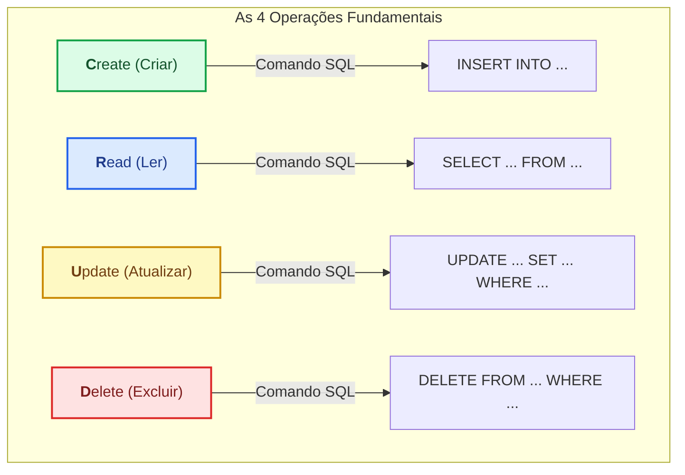
Na Semana 08, Aprendemos sobre conexão usando PDO e padrão Singleton. vamos dar vida a essa conexão: aprenderemos a inserir registros, consultar dados com filtros dimâmicos, atualizar e remover com segurança os dados do banco.

#### **2. A Maior Ameaça da História da WEB: SQL Injection (SQLi)

Antes de escrever as query de manipulação, precisamos aprender sobre os perigos que cercam o banco de dados

A vulnerabilidade `SQL Injection` ocupa o topo das listas de falha de segurança cibernética. Ela ocorre quando um desenvolvedor comete o erro gravíssimo de **concatenar entradas fornecidas pelo usuário diretamente na instrução SQL**

**Exemplo de Código Probido**:

```php
// código Vulnerável e Perigoso - Nunca faça isso
$usuario = $_POST["usuario"];
$senha = $_POST["senha"];
// o invasor digita: admin' --

$sql = "SELECT * FROM usuarios WHERE login = '".$usuario.
"' AND senha = '" . senha . "'";
$resultado = $pdo->query($sql);
```
**O que acoontece quando o atacante digita `admin '--`?**

```sql
SELECT * FROM usuarios WHERE login = 'admin' -- ' AND senha = '...';
```

1. A aspa digitada pelo atacante fecha a string do login antecipadamente
2 . O operador `--` no PostgrSQL indica o **início de um comentário** pelo motor do banco
3. o restante da query (a validação da senha! ) é
**ignorada** pelo motor de busca do banco 
4. **Resultado**: O invasor faz login instataneamente na conta do administrador sem precisar saber a senha!

---

### ***3. Cenários de SQL Injecton**

| Tipo de Injeção | Payload Injetado pelo Invasor | Consequência no PostgreSQL |
| :--- | :--- | :--- |
| **Bypass de Autenticação** | `' OR '1'='1` | A condição torna-se sempre verdadeira, retornando o primeiro usuário da tabela (geralmente o administrador do sistema). |
| **Exfiltração de Dados (UNION SQLi)** | `' UNION SELECT id, nome, senha FROM usuarios --` | O invasor anexa tabelas sigilosas inteiras no resultado da consulta visível na tela, violando a LGPD. |
| **Destruição / Adulteração (Stack Queries)** | `'; DROP TABLE pecas_industriais; --` | Dependendo do driver e das permissões do usuário, o invasor encerra a consulta atual e executa comandos de destruição em massa. |

#### 4. A Defesa Contra SQl Injection

Para eliminar vulverabilidade usa-se a **Prepared Statements (consultas Preparadas com PDO)**

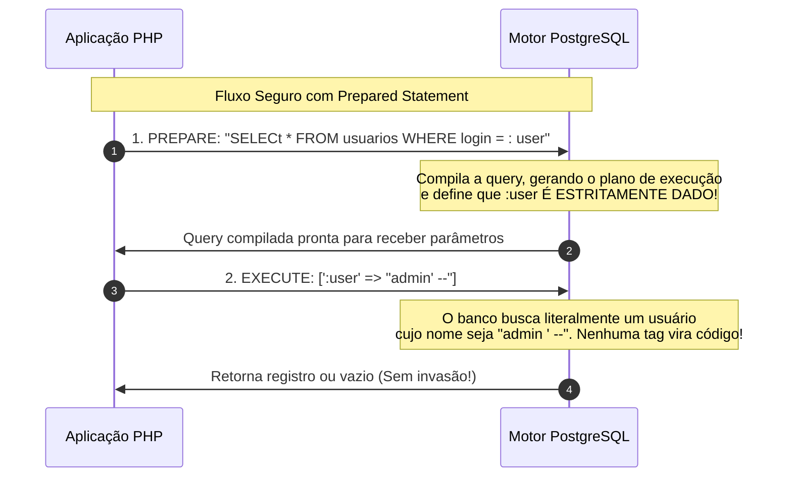
#### **5. Marcadores/Denominadores Nomeados**

O PDO aceita dois formatod de marcadores em prepare statement

**1. Posicionais (`?`)**

```php
//funciona, mas é sujeito a erros de contagem de parâmetros em queries longas
$sql = "INSERT INTO pecas (SKU, descricao, preco) VALUE (?, ?, ?);
$stmt = $pdo->prepare($sql);
$stmt->execute([$sku, $descricao, $preco]);
```

**2. Nomeação (`:nome`) - Padrão Recomendado**

```php
//Autoexplicativo, altamente legivel e á prova de inversão de ordem 
$sql = "INSERT INTO pecas (sku, descrição, preco) VALUE (:sku, :desc, :preco)";
$stmt = $pdo->prepare($sql);
$smtmt->execute([// usa-se um vetor chave valor para determinar a nomeção dos valores atribuidos
  ":sku" => $sku,
  ":desc" => $sku,
  "preco" => $preco
]);
```

#### **6. Método de Vinculação: `bindValue()` Vs. `bindParam()`**

Ao associar parâmetros a uma consulta `prepare`, pode-se utilizar dois métodos com comportamentos distintos. o `bindValue()` ou o `bindParam()`, o primeiro vincula um valor fixo no momento da chamada, enaquanto o segundo vincula uma variável por referência e só avalia o valor real quando a consulta é executada.

**Exemplo `bindValue()`
```php
$id = 10;
$stmt->BindValue(":id" , $id, PDO::PARAM_INT);
$id = 20; //não altera o valor que já foi passado no bindValue!
$stmt->execute(); //execute com id = 10
```

**Exemplo `bindParam()`** : Associa a variável como uma referência de memória (`&`). O valor é lido no momento exato da chamada `execute`.
Usar apenas em loops ou situações específicos que precisa alterar o valor repetidamente.
```php
$id = 10;
$stmt->bindParam(":id", $id, PDO::PARAM_INT);
$id = 20; //altera o valor da referência
$stmt->execute(); //execute co id = 20
```

> obs: tipagem explícita com constantes do PDO:
> Para Garantir que o PostgresSQL interprete corretamente o tipo de dado, informe sempre a constante correspondente:
> * `PDO::PARAM_INT`: Para chaves primárias, quantidades e inteiros.
> * `PDO::PARAM_STR`: Para textos, strings, datas e números decimais (`NUMERIC`).
> * `PDO::PARAM_BOOL`: Para valores booleanos (`true`/`false`).
> * `PDO::PARAM_NULL`: Para passar valores nulos explícitos.

#### **7. O Padrão de arquitetura DAO(DATA ACCES OBJECT)**

Em aplicações profissionais, comando SQL nunca devem ser escritos diretamente dentro de arquivos de interface visual ( como páginas HTML ou controladores de tela)

Para separar a **lógica de apresentação** da **lógica de acesso a dados**, usa-se o padrão de projetos **DAO(Data Access Object)**:

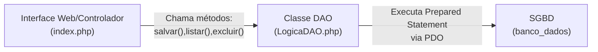

### Semana 10 - Sessões, Cookies e Autenticação Segura

**Tema:** Gestão de Estado com HTTP, Ciclo de Vida da Sessão(`$_SESSION`), Cookies, Hashing de Criptografia, Middlewares de Autenticação

#### **O Protocolo HTTP, Como ele Lembra de você?**

O protocolo **HTTP(Protocolo Web apenas por trocar informações mas não de amazenamento)** e **STATELESS (sem aramazenamento de estado)**. Isso significa que o servidor web trata cada requisição HTTP de forma isolada, como se fosse a primeira vez que ele estivesse interagindo com o usuário do sistema.

Para resolver esse problema sem o usuário a digitar o login e senha novamente a cada clique fazemos o seguinte:
1. Ao fazer o login bem-sucedido, o servidor entregaao cliente uma **comanda/pulseira VIP numerada* (um identificaor de sessão única e aleatória).
2. O navegador armazena essa comanda/pulseira em um **cookie**.
3. A cada nova página solicitada, o navegador apresenta automaticante  essa pulseira no cabeçalho da requisição 
4. O PHP lê o número da comanda/pulseira, localiza os dados do usuário armazenados na memória do servidor(`$_SESSION`) e reconhece quem é ele!

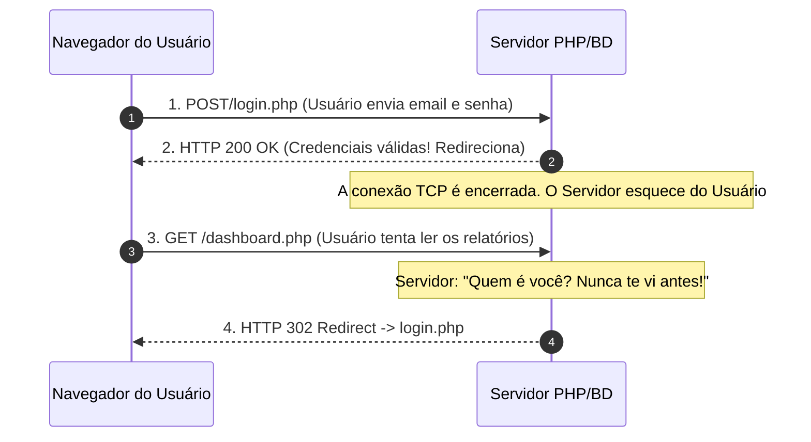

**Situação com Armazenamento de Cookie e SESSION**

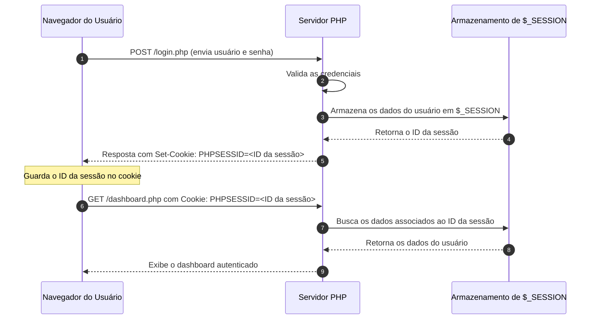

#### **Como funciona o COOKIE HTTP**

um **Cookie** é um pequeno arquivo de texto (geralmente limitado a 4KB) gravado pelo navegador a pedido do servidor através do cabeçalho de resposta `Set-cookie`.

**Cookies podem vazar informação**

Sim, se um cookie de sessão for configurado com parâmetros desprotegidos, qualquer script malicioso injetado na página (XSS)
pode roubar a sessão do usuário logado.

**Para evitar problema de segurança em Cookies:**

| Flag de Segurança | O que ela faz? | Por que é indispensável? |
| :--- | :--- | :--- |
| **`HttpOnly`** | Impede que scripts JavaScript executem leitura no cookie via `document.cookie`. | **Neutraliza o roubo de sessão via XSS!** Mesmo que haja uma falha de injeção de script na tela, o navegador proíbe o JavaScript de ler o identificador de sessão. |
| **`SameSite=Lax`** | Restringe o envio do cookie apenas a navegações originadas do próprio domínio. | **Protege contra ataques CSRF** (*Cross-Site Request Forgery*), impedindo que links externos forjem ações logadas. |
| **`Secure`** | Garante que o cookie só seja transmitido em conexões criptografadas com **HTTPS**. | Impede que bisbilhoteiros em redes Wi-Fi públicas interceptem a sessão em trânsito (*Man-in-the-Middle*). *(Em ambiente local de desenvolvimento sem SSL, pode ser desativado temporariamente).* |

#### **O ciclo de Vida da sessão em PHP: `$_SESSION` no Servidor**

Enquanto os cookies residem no Navegador, os dados da sessão ficam armazenados com **privacidade total dentro do servidor** (em arquivos temporários na memória).

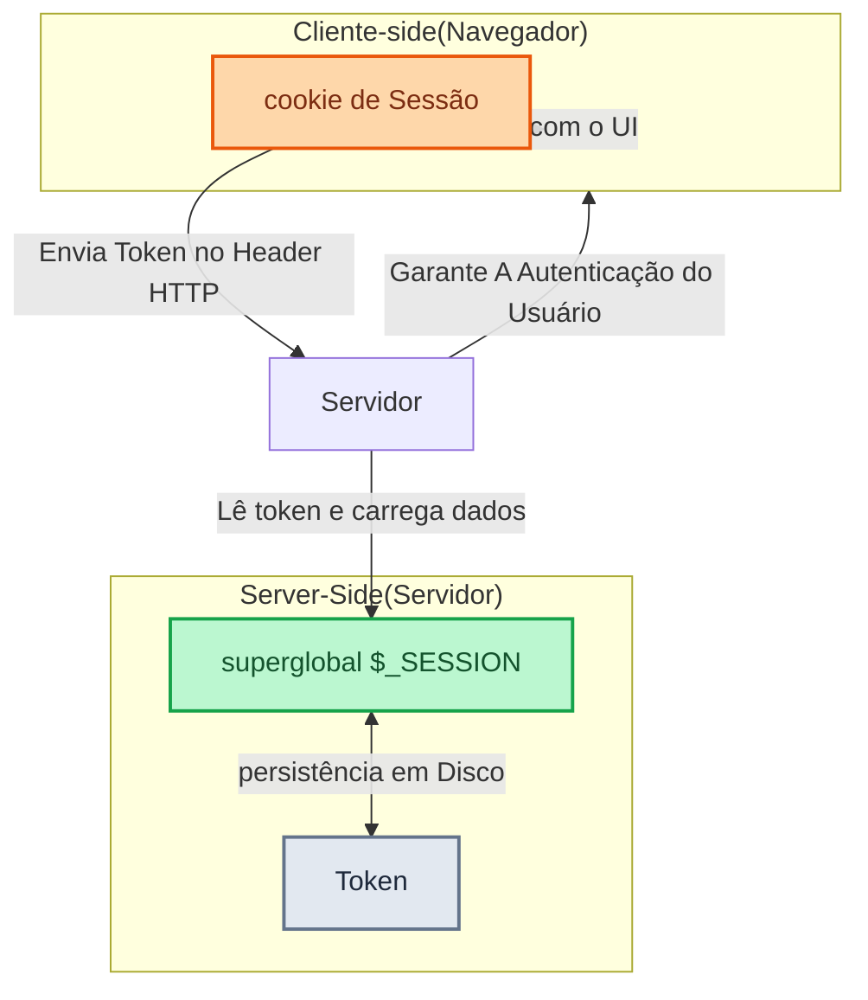

**Sintaxe Essencial do PHP para Sessões**

```php
//configurando a sessão com funções pré-definidas no PHP (documentação)

//1. Configurar as flags dos cookies Antes de abrir a Sessão
session_set_cookie_params([
  "lifetime" => 0, //cookie expira ao fechar o navegador
  "path"   => "/" // válido para todo o domínio do site
  "httponly" => true //proteção contra XSS
  "samesite" => "Lax" //Proteção contra CSRF
]);

// 2. Iniciar ou restaurar a session ativa 
session_start();

// 3 . Gravar os dados da sessão (após validar o login)
//usar a superglobal($_SESSION) para isso
$_SESSION["usuario_id"] = 10;
$_SESSION["usuario_perfil"] = "ADMIN";


// 4. permitir a leitura dos dados em qualquer página do meu site 
$idLogado = $_SESSION["usuario_id"] ?? null; // se o usuario não tiver feito o login a session é null


```

#### **Criptografia de Senhas**

No passado, desenvolvedores armazenavam senhas utilizando funções matemáticas de integridade como `md5($senha)` ou `sha1($senha)`.

> O md5 foi quebrado em 2004 e SHA1 foi quebrado em 2017. 

**A Solução Moderna é criptografuia com uso de Hash**

O padrão de criptografia Moderna é o **Argon2id**, complentado pelo **bcrypt**

**Características da Cryptografica de Hash**:
1. **Unidirecional(One-Way):** É  matematicamente impossivel descriptografar o hash para recuperar a senha original.
2. **salt Automático e Aleatório**: cada execução, função gera um vetor de `salt` unico de 16 bytes. mesmo que 2 pessoas tenham o mesma senha, os hashes gerados serão completamente diferentes!
3. **Custos Ajustáveis**: É possivel calibrar quanto tempo e quanta memória o algoritmo levará para calcular o hash.


**Sintaxe Profissional de Cryptografia Moderna**

```php
$senhaDigitada = "123456"
$senhaInformada = $_POST["senha"];
$hashDoBanco    = $usuario["hash"];

// gerar a hash utilizando argon2id (ou Bcrypt)
$hash = password_hash($senhaDigitada, PASSWORD_ARGON2ID); // isso será armazenado no banco
// Saída: $argon2id$v=19$m65536,t=4,p=1$FSGJhfavdb...(comprimeto ~96 a 128 chars)

// processo de Verificação
if(password_verify($senha_Informada, $hashDoBanco)){
  //senha correta
}else {
  //senha incorreta
}

```

> [!aviso]
>Nunca tente fazer (password_hash($senha) === $hashDoBanco)
>como o `password_hash`gera um salt aleatório a cada milisegundo, a comparação por igualdade **sempre dará falso**
>A Verificação deve ser feita **exclusivamente com a função nativa `password_verify()`


#### **arquitetura de Autenticação: Middleware**

para inpede que visitantes não logados acessem páginas privadas (como dashcoard.php ou relatórios.php), criamos interceptadores chamados **guard(Middlewares de proteção)**.

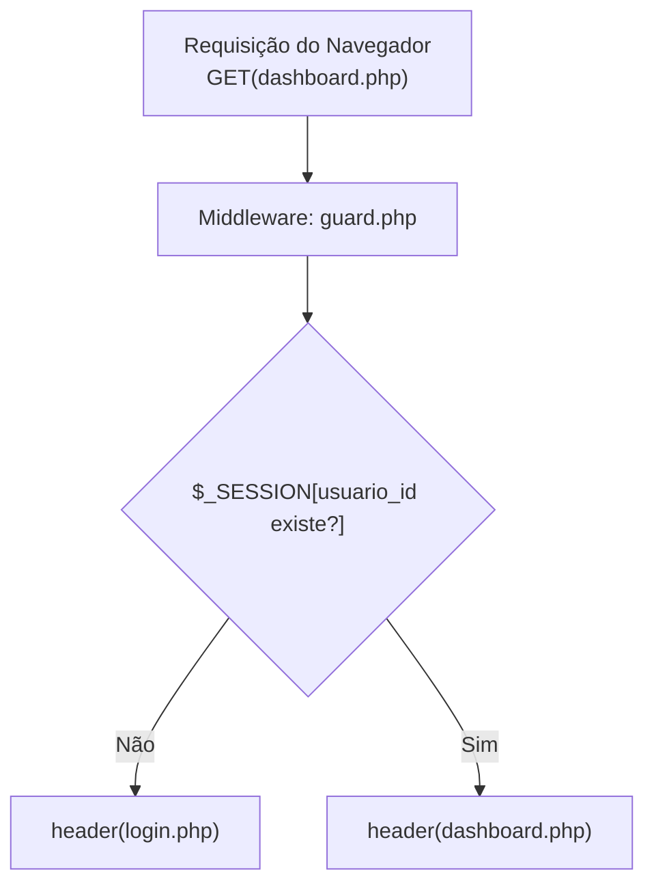
**Como usar o guard.php**:

Em todas as páginas restritas do sistema a **primira linha de código** após o `declare(strict_types=1)` será:

```php
require_onde __DIR__ . "/src/guard.php";
```
Se a pessoa não estiver autenticada ou não tiver o perfil de acesso, ela é expulsa antes mesmo que qualquer bytes de HTML seja renderizado

---

### Semana 11 - Programação Orientada a Objetos Em PHP

**Tema:** Paradigma de POO, Os 4 pilares da Orientação a Objetos(Abstração, Encapsulamento, Herança e Polimorfismo), Classes e Instância, Construtores, Modificadores de Acesso (Private, Protected, Public) e Modelagem de Dados.

#### **Do Procedural à Orientação a Objetos**

Manipilação de variáveis, laços de repetição e funções de forma linear, ou seja, todo o código é escrito em um monobloco(`código em um único arquivo de programação`). Essa abordagem resolve problemas lineares com maestria, mas colapsa rapidamente quando sistemas crescem em escala, complexidade e criticidade de regras de negócio.

Na programação procedual:

1. **Os dados estão expostos:** qualquer função pode alterar qualquer campo a qualquer momento
2. **As regras de validação ficam dispersos:** Cada tela precisa checar uma função, gerando dezenas de `if/else` duplicados espalhados pelo código. Se uma regra mudar, o desenvolver precisa lembrar de atualizar todos os arquivos do sistema.
3. **Não há garantias de invariantes:** É impossível garantir que um dado sempre permaneça em estado consistente.

**O que é paradigma Orientada a Objetos (POO)?**

Na **POO**, em vez de separar funções de um lado e dados soltos do outro, nós unimos *dados(atributos)* e as *funções que manipulam esses dados(métodos)* dentro de uma única estrutura chamada **Objeto**.

| Aspecto | Paradigma Procedural | Paradigma Orientado a Objetos (POO) |
| :--- | :--- | :--- |
| **Unidade Fundamental** | Procedimentos e Funções soltas | Classes e Objetos |
| **Proteção de Dados** | Nenhuma (dados globais ou em arrays abertos) | Alta (Encapsulamento com atributos privados) |
| **Reuso de Código** | Inclusão de scripts (`require_once`) e cópia | Herança (`extends`), Composição e Interfaces |
| **Tratamento de Variações** | Blocos gigantes de `switch` e `if/else` | Polimorfismo e Classes Abstratas |
| **Manutenibilidade** | Complexa à medida que a base de código cresce | Alta, modular, testável e pronta para arquiteturas corporativas (MVC, DDD, Clean Architecture) |


#### **Anatomia de uma classe**

- **classe**: é molde, a planta baixa, o projeto de engenharia. ela descreve quais atributos(dados) e comportamentos(métodos) as entidades daquelas tipo possuirão.
ela reside no código-fonte e não ocupa espaço dinâmico de dados na memória.
- **Objetos**: é o produto final construido a partir do molde, uma instância real, palpável e viva alocada na memória do servidor durante o ciclo de execução.


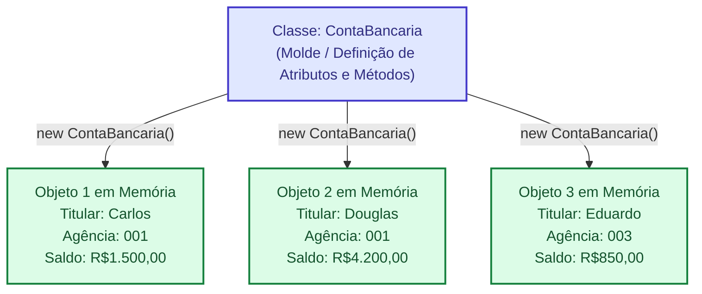

**O ciclo de Instanciamento de Objetos**

Ao instanciar um objeto com a instrução `new`, o PHP incoca o método construtor especial `__constructor()`. E usamos a palavra-chave `$this` para fazer referência direta e exclusivamente ao **atributo que está sendo executado pelo código naquele momento**.

```php

class contaBancaria{
  //declaração tradicional de atributos tipados
  private string $titular;
  private int $agencia;
  private float $saldo;

  //Método construtor
  public function __constructor(string $titular, int $agencia, float $saldo){
    $this->titular = titular; //$this-> titular refere-se ao atributos da classe
    $this->agencia = agencia;//$this->agencia refere-se ao atributos da classe
    $this->saldo = saldo;//$this->saldo refere-se ao atributo da classe
  }

  // método de acesso
  public function getSaldo(): float{
    return $this->$saldo;
  }
}

//instanciando dois objetos completamente independentes
$conta1 = new contaBancaria("Carlos", 001, 100.00);
$conta2 = new contaBancaria("Douglas", 003, 500.00);

echo $conta1->getSaldo();//Exibe 100.00
echo $conta2->getSaldo();//Exibe 500.00
```

> [!OBS:]
> **Alocação de Objetos na Memória**
> No PHP, variáveis que armazenam objetos, usam um **identificador/referêncai para o endereço na memória**. quando você passa um objeto para uma função ou método, está passando a referência na memória. o que torna p POO extremamente performátivo.

#### **Os 4 pilares da Orintação a objetos**

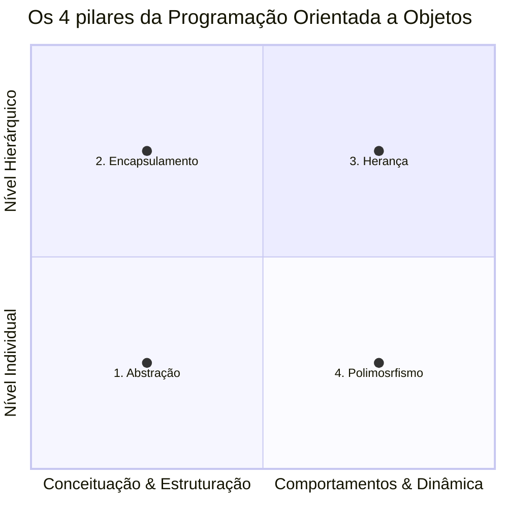
1. **Pilar 1: Abstração**
**Definição:** Capacidade de filtrar etalhes irrelevantes e focar estritamente nas caracteristicas e comportamentos essenciais da entidade para o contexto do software que está
sendo construido.
*Exemplo*: Para um sistema bancário, o que importa em um cliente é seu nome, CPF e renda. Sua cor favorita ou altura são abstrações e podem ser descartadas

2. **Pilar 2: Encapsulamento**
**Definição:** Blindagem dos estado interno do objeto. Os atributos devem ser protegisdo contra acesso ou modificações diretamente do mundo exterior. Alterações no estado só ocorrem através de métodos públicos que validam regras de negócio e mantêm invariantes contábeis.

3. **Pilar 3: Herança**
**Definição**: Mecanismo pelo qual uma classe filha (subclasse) herda atributos e comportamentos de uma classe ancestral (superclasse), promovendo o reuso de códigos e estabelecendo uma relação do tipo **É UM**
*Exemplo:* um Cachorro(subclasse) é um Mamífero(superclasse) 
-> porque ele herda características da classe dos Mamíferos

4. **Pilar 4: Polimosrfismo**
**Definição:** Princícipo que permite  que classes filhas diferentes respondam a mesma chamada de método com implementações especializadas e comportamentos distintos. O Chamador não precisa saber qual subclasse exata está executando, apena confia que o método cumprirpa o contrato. 

#### **Encapsulamento Rigoroso**

Os Modificadores de visibilidade:

| Modificador | Onde pode ser acessado? | Recomendação de Uso |
| :--- | :--- | :--- |
| **`private`** | **Apenas** dentro da própria classe que o declarou. Subclasses e scripts externos não conseguem ler nem alterar. | **Padrão ouro para atributos.** Garante proteção absoluta de estado e impede efeitos colaterais. |
| **`protected`** | Dentro da própria classe e por quaisquer **subclasses que a herdem (`extends`)**. O mundo exterior continua bloqueado. | Usado quando subclasses precisam ler ou ajustar diretamente um valor compartilhado (ex.: `$saldo` em classes filhas de conta). |
| **`public`** | Acessível livremente por **qualquer parte do sistema**, dentro ou fora da classe. | Usado para os métodos que compõem a **interface pública** do objeto (ações como `sacar()`, `depositar()`, `transferir()`). |

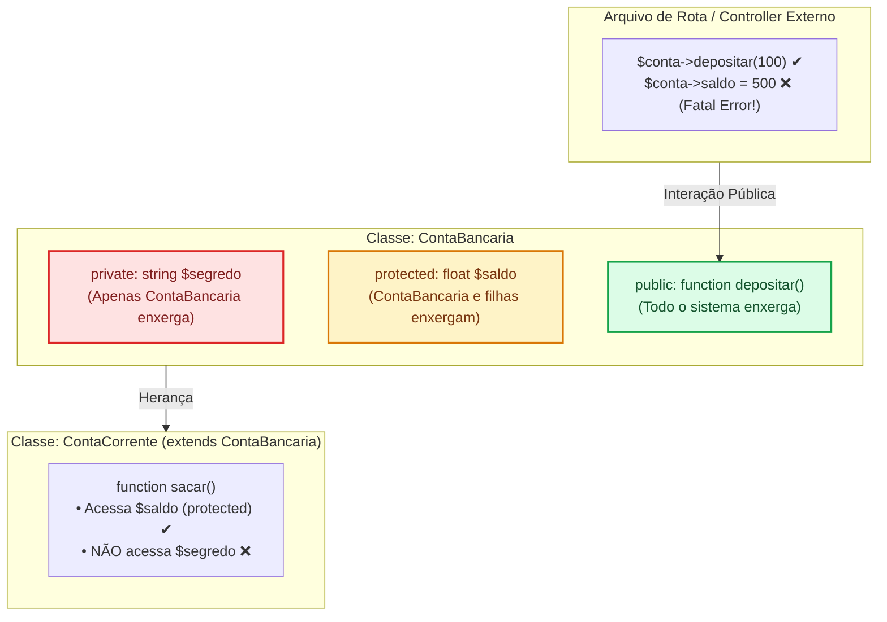

**Usando  Getter and Setters**

Ao declarar Atributos privados se você deseja manipular esses atributos privados é importante criar os modificadores de Acesso através dos *getters and setters*

ao criar um atributos `float $saldo`

para modificar os valores do saldo ou ler o saldo é importante criar os métodos públicos

`public function getSaldo()`: permite consultar o valor do saldo 

`public function setSaldo()`: permitir modificar o valor de saldo

>[!Cuidado]
> **Não destrua seu encapsulamento** : para atributos que não serão modificados como CPF por exemplo não há necessidade de criar um `setCPF` o CPF de uma pessoa não será modificado ao longo da vida.

**Construtor Property Promotion (declaração no Construtor)**

No PHP 8.X Podemos utilizar recursos modernos que reduzem o código repetitido e elevam a segurança. o uso do `Property Promotion` no construtor é um exemplo, não precisamos declarar os atributos e depois fazer o construtor, basta declarar os atributos diretamente dentro do construtor

```php 
class TitularProperty {
    public function __construct(
        private string $nome,
        private string $cpf
    ){}
} 
// é igual que

class TitularSemproperty {
  private string $nome;
  private string $cpf;

  public function __construct(string $nome, string $cpf){
    $this->nome = $nome;
    $this->cpf = $cpf;
  }
}
```
#### **Herança, Classes Abstratas e Polimorfismo**

**Classes Abstratas**: Uma Classe abstrata é uma superclasse conceitual que **Não pode ser instanciada diretamente com `new`**. Ela serve como matriz para que subclasse concretas seja derivados.
```php
abstract class ContaBancaria {
    //classe filhas herdam esta propriedade protegida
    protected float $saldo;

    public function __construct(float $saldoInicial =0.0){
        $this->saldo = $saldoInicial;
    }

    public function getSaldo(): float {
        return $this->saldo;
    }

    //método abstrato: Obriga a subclasse a fornecer sua própria implementação
    abstract public function sacar(float $valor): void;
}
//se um objeto da classe ContaBancaria tentar ser instanciado vai gerar um erro na compilação
$conta = new ContaBancaria(); //erro: Cannot instantiate
```

**Herança:** é um mecanismo que permite que uma classe(subclasse) herde atributos e métodos de outra classe (superclasse)

```php
class ContaCorrente extends ContaBancaria {
  public function sacar(float $valor): void{
    //Implementa especificamente para Conta Corrente
      $this->saldo -= $valor + 2.50; //Taxa de Saque
  }
}

class ContaPoupanca extends ContaBancaria {
  public function sacar(float $valor): void {
    $this->saldo -= $valor; //não tem taxa de saque
  }
}

$contaCorrente = new ContaCorrente(1000.00);
$contaCorrente = new ContaPoupanca(500.00);

$contaCorrente->sacar(100.00); //Deduz R$ 102,50 do saldo
$contaPoupanca->sacar(100.00); //Deduz R$100,00 do saldo

$contaCorrente->getSaldo(); // Retorna 897,50
$contaPoupanca->getSaldo(); // Retorna 400,00
```
>observer que ambas as classes implementam o método `sacar()`de maneira doferente, respeitando as regras de negócio espefícicas de cada tipo de conta.

**Polimorfismo:** O método `sacar()` na classe ContaBancaria
demostra o polimorfismo em ação

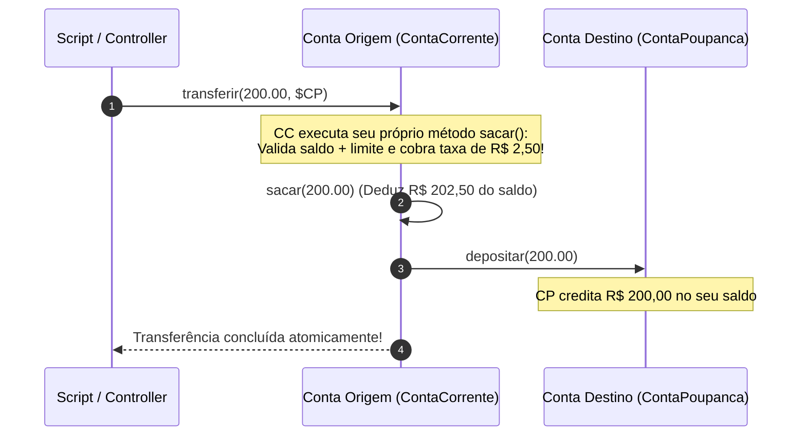

#### **Exceções de Domínio: Tratamento de Erros do sistema**

Um dos maiores erros cometidos em sistema procedurais é o retorno mágico de valores como `-1`, `false` ou `null` quando uma regra de negócio é violada.

**Para Corrigir esse erros Mágicos devemos usar `throw Exception`
se o método retorna `false` quando ocorrer um erros o desenvolvedor não fez o tratamento de erros corretamente.
exemplo. Se o `sacar()` retornar `false` quando não houver saldo, o sistema continuará executando como se o dinheiro tivesse saído causando furos de caixa no sistema. já quando usamos uma **Exceção de Comínio**, a execução é interrompida e feito um tratamento usando um bloco `try/catch`.

```mermaid
flowchart TD
    op["Operação: $conta->sacar(5000.00)"] --> check{"Saldo suficiente?"}
    check -- Sim --> ok["Deduz saldo e prossegue normalmente"]
    check -- Não --> erro["throw new SaldoInsuficienteException(...)"]
    
    erro --> intercept["Interrompe execução imediata!"]
    intercept --> catchBlock["try { ... } catch (SaldoInsuficienteException $e) {<br/>    // Captura segura e mensagem amigável para o usuário<br/>}"]

    style ok fill:#dcfce7,stroke:#16a34a,stroke-width:2px,color:#14532d
    style erro fill:#fee2e2,stroke:#dc2626,stroke-width:2px,color:#7f1d1d
    style catchBlock fill:#e0e7ff,stroke:#4338ca,stroke-width:2px,color:#312e81
```

> [!OBS]
>`try/catch` é o mecanismo de captura de exceções do PHP. ele permite que você trate erros de forma inteligente, mantendo a integridade do sistema e fornecendo feedback claro ao usuário.

---

### Semana 12 - Arquitetura MVC Artesanal, AutoLoad com Composer e Front Controller

**Tema**: Padrão Arquitetural Model-View-Controller (MVC) cm BackEnd, Gerenciamento de Dependências com Composer, Autoloading PSR-4, Resolução Automática de NameSpace, Padrão Front Controller, Roteador HTTP Artesanal.

#### **1. O Fim do `Codigo Espaguete`**

Quando enconrtamos uma padrão de código desastroso e caótico, sem arquiterua modernas de desenvolvimento, usamos o termo `código espaguete`. 

Exemplo de Código Espaguete:

```php
<?php
// 1. Múltiplos includes manuais frágeis
require_once __DIR__ . '/../config/conexao.php';
require_once __DIR__ . '/../classes/Produto.php';
require_once __DIR__ . '/../classes/Sessao.php';
require_once __DIR__ . '/../classes/Auditoria.php';

// 2. Mistura de lógica de banco e processamento HTTP
$pdo = Conexao::getInstancia();
if ($_SERVER['REQUEST_METHOD'] === 'POST') {
    $nome = $_POST['nome'];
    $stmt = $pdo->prepare("INSERT INTO produtos (nome) VALUES (?)");
    $stmt->execute([$nome]);
}
$produtos = $pdo->query("SELECT * FROM produtos")->fetchAll();
?>
<!-- 3. HTML misturado com PHP procedural na mesma folha -->
<html>
<body>
    <h1>Catálogo</h1>
    <?php foreach($produtos as $p): ?>
        <p><?= $p['nome'] ?></p>
    <?php endforeach; ?>
</body>
</html>
```

**Os Problemas Críticos do Código Espaguete**

1. *Acoplamento Máximo*: Se você mudar o layout visual, corre o risco de quebrar uma query SQL. Se alterar uma coluna do banco, precisa reescrever o arquivo visual.
2. *Fragilidade de Inclusões (`required_once`)*: Se um arquivo for movido de pasta, todas as chamadas `require_onde`quebram com erros fatais de arquivo não encontrado.
3. *Exposição de Segurança*: Se os arquivos PHP estiverem na raiz acessível do servidor web, qualquer usuário malicioso pode tentar acessar scripts internos digitando `http://site.com/config/conexao.php`

```mermaid
flowchart TD
    subgraph Caotico ["Código Espaguete Tradicional (Desorganizado)"]
        arq["produtos.php<br/> * Consultas SQL Diretas<br/> * HTML e TAGs CSS<br/>*10 required_once manuais"]
    end

    style Caotico fill:#fee2e2, stroke:#dc2626, stroke-width:2px, color:#7f1d1d

```

#### **A tríade Model-View-Controller (MVC) no BackEnd**

O padrão **MVC (model-view-controller)** é a arquitetura de software corporativa mais consagrada da história do desenvolvimento. Seu objetivo é separar as preocupações do sistema em **3 Camadas Bem definidas&**.

1. **Model(Camada de modelo de Negócios e dados)**
- **O que faz:** Representa as entidade do mundo real e gerencia a lógica de dados, persistência e regras de Negócio.
- **O que sabe:** Sabe como conectar ao banco de dados, execute Prepared Statement, validar as Regras de Negócio.
- **O que NUNCA faz:** Nunca emite comandos `echo`, mumca gera tags HTML e nunca lê dados da SuperGlobal `$_POST` ou `$_GET`

2. **View (Camada Visualização e Apresentação)**
- **O que Faz:** Renderizza a interface gráfica do usuário (geralmente HTML, CSS e JSON).
- **O que Sabe:** Recebe variáveis simples enviadas pelo controller e as formata visualmente, aplicando sanitização ativa contra XSS(`htmlspecialchars`).
- **O que NUNCA Faz:** Nunca executa consulta SQL, nunca faz regras de negócio complexas e nunca redirecionas as requisições via `header()`

3. **Controller (Camada de Controle e Orquestração)**
- **O que Faz:** Atua como maestro da aplicação. Recebe a requisição do usuário , valida as entradas, aciona a camdaModel para obter ou persistir informações e seleciona a View correspondente para renderizar a resposta. 
- **O que Sabe:** Sabe qual Model chamar e qual view ele tem que devolver
- **O que NUNCA Faz:** não deve conter regras contábeis complexas (elas pertencem ao Model) e não deve escrever HTML
diretamente.

```mermaid
flowchart TD

    subgraph MVC ["Padrão Arquitetural MVC (Responsabilidade Única)"]
        controller["Controller<br/>(Maestro do Fluxo)"]
        model["Model<br/>(Regras de Negócio & Banco)"]
        view["View<br/>(Apresentação Visual Limpa)"]

        controller -->|"1. Pede dados"| model
        model -->|"2. Devolve entidades"| controller
        controller -->|"3. Injeta dados"| view
    end

    style controller fill:#e0e7ff,stroke:#4338ca,stroke-width:2px,color:#312e81
    style model fill:#dcfce7,stroke:#15803d,stroke-width:2px,color:#14532d
    style view fill:#fef3c7,stroke:#d97706,stroke-width:2px,color:#78350f
```

```mermaid
sequenceDiagram
    autonumber
    actor Cliente as Navegador do Usuário
    participant FC as Front Controller (index.php)
    participant Router as Roteador HTTP
    participant Ctrl as ProdutoController
    participant Model as Produto (Model)
    participant BD as Banco de Dados (PostgreSQL)
    participant View as View (listar.php)

    Cliente->>FC: GET /produtos
    FC->>Router: despachar("GET", "/produtos")
    Router->>Ctrl: executar listar()
    Ctrl->>Model: listarTodos()
    Model->>BD: SELECT * FROM produtos...
    BD-->>Model: Retorna registros relacionais
    Model-->>Ctrl: Retorna array de entidades
    Ctrl->>View: renderizar("produtos/listar", dados)
    View-->>Cliente: Retorna HTML estruturado e sanitizado
```

#### **O Gerenciador Composer e o AutoLad PSR-4**

Imagine um projeto corporativo moderno com mais de 300 classes. ter que escrever 300 linhas de `required_once` em cada arquivo tornaria o desenvolvimento inviável. É aqui que entra o **Composer** e a especificação **PSR-4**.

**O que é o Composer?**

O Composer é o gerenciador de dependências oficiais da linguagem PHP. ele desempenha duas funções vitais:

1. baixar bibliotecas de terceiros a partir do repositório central Packagist (como biblotecas de envio de e-mail, geradores de PDF e frameworks).
2. Gerar o autoloader Automático: O composer lê as classes criadas por você no seu projeto e te dispolibiliza automaticamente no código sem a necessidade de nenhum `require`

**A Especificação PSR-4 (PHP Stardard Recommendation 4)**

A especificação internacional **PSR-4** fala que:

> O namespace de uma classe deve espelhar exatamente a estrutura de diretórios do disco físico onde o arquivo está gravado.

Exemplo prático:
- Se declaramos o namespace: `namespace App\Controller; class ProdutoController{}`;
- É configura no composer que o prefixo `App\\` aponta para a pasta `src/`.
- O PHP localiza fisicamente o arquivo em `src/Controllers/ProdutoController.php`

**Configurando o `composer.json`


```json
{
    "name": "senai/supply-mvc",
    "description": "Sistema de Gestão de Insumos Industriais",
    "type": "project",
    "autoload": {
        "psr-4": {
            "App\\": "src/"
        }
    }
}
```


```mermaid
flowchart LR
    comp["Composer<br/>(composer.json)"] -->|"composer dump-autoload"| auto["vendor/autoload.php"]
    
    codigo["use App\\Models\\Produto;<br/>$p = new Produto();"] -->|"PHP intercepta a chamada"| auto
    auto -->|"Mapeia 'App\\' para 'src/'"| disco["Carrega do disco:<br/>src/Models/Produto.php"]

    style comp fill:#fed7aa,stroke:#ea580c,stroke-width:2px,color:#7c2d12
    style auto fill:#bbf7d0,stroke:#16a34a,stroke-width:2px,color:#14532d
    style disco fill:#e0e7ff,stroke:#4338ca,stroke-width:2px,color:#312e81
```

> [!IMPORTANT]
> **Comando Mandatório de Regeneração:**  
> Sempre que você criar o arquivo `composer.json` ou alterar a estrutura de namespaces, execute no terminal do VS Code:  
> `composer dump-autoload -o`  
> O parâmetro `-o` gera o mapa de classes otimizado para máxima performance.


#### **O Padrão Front Controller e Roteamento HTTP**

#### **O Padrão Front Controller e Roteamento HTTP**

Em aplicações PHP procedurais antigas, a URL do navegador correspondia exatamente a um arquivo gravado no disco:
- `http://site.com/contato.php` ➔ Carrega o arquivo `contato.php`.
- `http://site.com/admin/relatorio.php` ➔ Carrega o arquivo `admin/relatorio.php`.

Em arquiteturas corporativas modernas (incluindo **Laravel**, **Symfony** e **Spring Boot**), essa correspondência direta não existe mais. Em vez disso, utilizamos o **Padrão Front Controller**.

```mermaid
flowchart TD
    req1["GET /"] --> fc["Ponto Único de Entrada:<br/>public/index.php"]
    req2["GET /produtos"] --> fc
    req3["POST /produtos/salvar"] --> fc

    fc --> router["Roteador Artesanal<br/>(App\\Core\\Roteador)"]

    router -->|"Combina Rota"| c1["HomeController::index()"]
    router -->|"Combina Rota"| c2["ProdutoController::listar()"]
    router -->|"Combina Rota"| c3["ProdutoController::salvar()"]
    router -.->|"Não encontra"| c4["HTTP 404 Not Found"]

    style fc fill:#fed7aa,stroke:#ea580c,stroke-width:2px,color:#7c2d12
    style router fill:#dcfce7,stroke:#16a34a,stroke-width:2px,color:#14532d
    style c4 fill:#fee2e2,stroke:#dc2626,stroke-width:2px,color:#7f1d1d
```

**Por que isolar o diretório `public/`?**

Por razões estritas de **Segurança da Informação**:
1. O servidor web aponta sua raiz estritamente para a pasta `public/`.
2. As pastas `src/`, `config/`, `vendor/` e os arquivos `.ini` e `.env` ficam **um nível acima da raiz pública**.
3. Mesmo que um atacante tente digitar diretamente a URL de um arquivo sensível (ex.: `http://site.com/config/database.ini`), o servidor web bloqueia o acesso, pois o arquivo não reside na pasta pública.


---

### Semana 13 - Framework Laravel e Artisan CLI

**Tema:**Introdução ao Framework Laravel, Evolução da Arquitetura MVC Artesanal para o Ecossistema Laravel, Estrutura Enxuta, mapeamento de Diretórios(`app/`, ``config/``, `database/`, etc), Gestão Segura de Ambientes, Criptografia de aplicação(APP_KEY) Ferramenta de linha de comando artisan CLI (command line Interface), Ciclo de vida no framework e Criação da primeira aplicação Laravel

#### **1. A Evolução do MVC**

Ao longo das últimas Semanas estudamos a estrutura de projetos em PHP e agora Vamos começar com o Módulo 3 - Laravel,

> Construtir o MVC Artesanal na semana 12  foi como desmontar e forjar a mão cada engranagem, pistão e freio de um motor automotivo. Agora que você compreendeu como o montor funciona, não precisa mais reinventar a roda em cada nova fase, você já assume a cabine do piloto de Fórmula 1 de última Geração. 

**O que é o Framework Laravel**

Criado em 2011 por Taylor Otwell, O *Laravel* é atualmente o framework backend mais popular e consolidado do mundo. Ele adota o principio de *Convenção sobre Configuração* e Entrega os seguinte Conteúdos:
1. **POrdutividade Imediata**: Estrutura padronizada onde todo desenvolvedor sênior sabe exatamente onde encontrar controllers, models, rotas e views.
2. **Segurança por Padrão(Security by Default)**: Proteção nativa e automática contra XSS, CDRF, SQL Injection, manipulação indevida de cookies e fixação de sessão
3. **Ferramental de Limnha de Comando(Artisan CLI)**: Automatiza a criação de classes, execução de migrações de banco, limpeza de cache e siagnósticos. 
4. **Comunidade Global e Ecossistema Rico**: Milhares de pacotes prontos para autenticação robusta, mensageria, fila assincronas, geração de APIs Restful e websockets.

 Componente Arquitetural | No Seu MVC Artesanal (Semana 12) | No Framework Laravel (Semana 13+) | Vantagem Competitiva no Mercado |
| :--- | :--- | :--- | :--- |
| **Ponto Único de Entrada** | `public/index.php` | `public/index.php` | Mesma raiz segura: isola todo o código-fonte da web pública. |
| **Autoload de Classes** | `composer.json` (PSR-4: `"App\\": "src/"`) | `composer.json` (PSR-4: `"App\\": "app/"`) | Padrão unificado internacional da PHP-FIG. |
| **Mecanismo de Roteamento** | `App\Core\Roteador` com array interno | `routes/web.php` e `routes/console.php` | Roteamento declarativo com middlewares, parâmetros dinâmicos e grupos de rotas. |
| **Camada de Controle** | `App\Controllers\ProdutoController` | `App\Http\Controllers\AtivoController` | Integração automática com Injeção de Dependências e validação de Form Requests. |
| **Camada de Dados (Model)** | `App\Models\Produto` com PDO manual | `App\Models\Ativo` (*Eloquent ORM*) | Mapeamento Objeto-Relacional avançado com relacionamentos expressivos (`hasMany`, `belongsTo`). |
| **Camada de Visualização** | Scripts PHP nativos com `extract()` | Motor de Templates **Blade** (`.blade.php`) | Sintaxe limpa, herança de layouts, componentes reutilizáveis e escape automático contra XSS. |
| **Isolamento de Credenciais** | `config/database.ini` | Arquivo `.env` (Padrão 12-Factor App) | Paridade entre ambientes (local, homologação e nuvem) com segurança estrita. |